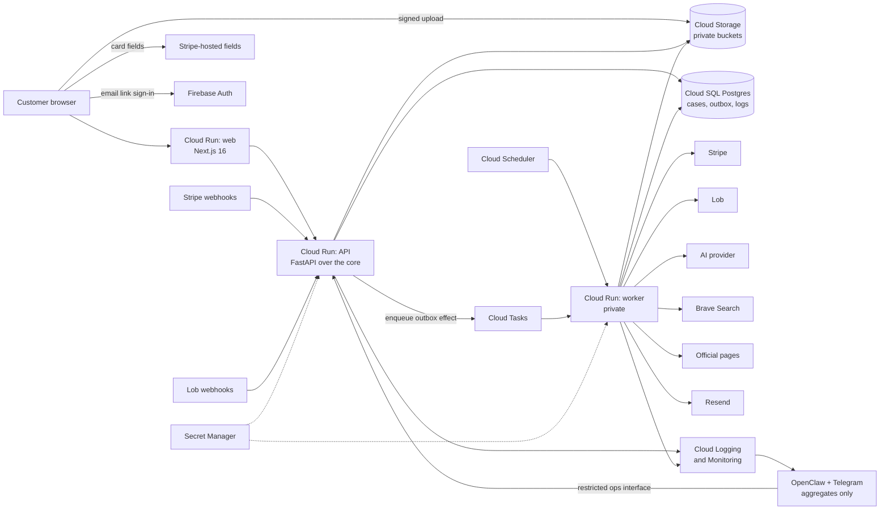
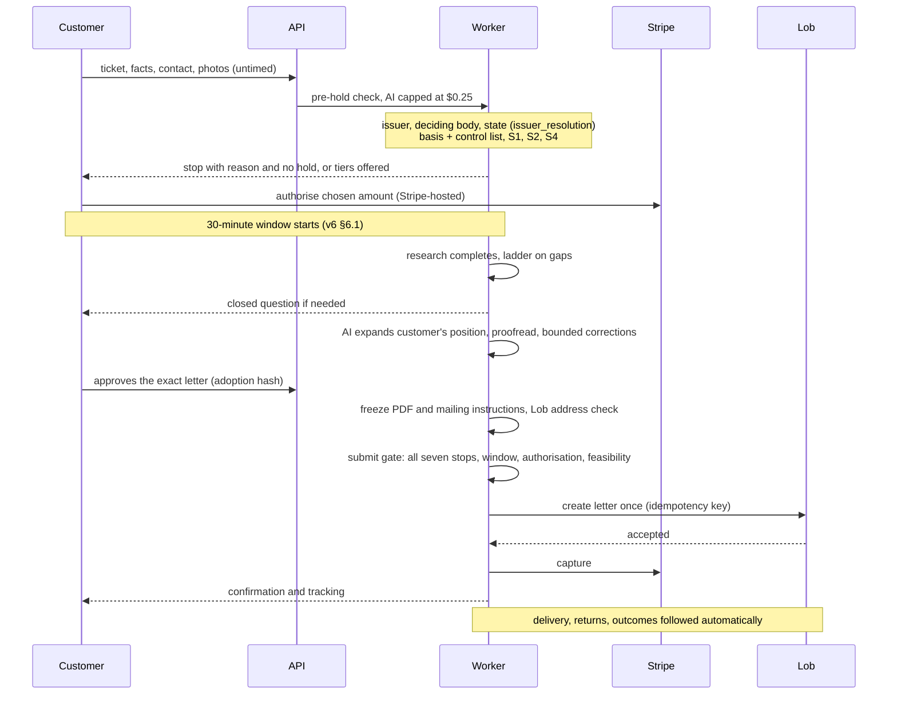

# ParkingBreaker: Production Deployment and Operations Architecture (v8)

**Status: ACCEPTED 2026-10-13 under the owner's delegation of the open decisions to the
supervisor; [business-strategy.md](business-strategy.md) amends §6, §7, §10, §11 and §14.** v6 and v7 remain binding for every section this document does not change.

v6 ([architecture-v6.md](architecture-v6.md)) and v7 ([architecture-v7.md](architecture-v7.md))
define what the system decides. Neither says where it runs, how it is deployed, how it survives
restarts and repeats in production, or how it is operated without the owner. v8 is that
chapter. It states only what is new. **Where v8 is silent, v6 and v7 are unchanged and
binding;** where they differ, v8 wins only on deployment and operations. Labels are the same
as v6: **DECIDED (owner)**, **DESIGN**, **ASSUMPTION**, **CONFIRM AT BUILD**, plus
**DECIDED (delegated)** for decisions made under the owner's delegation (business-strategy.md).

Sources: the owner-approved consolidated decision record of 2026-10-13, the supervisor's five
corrections to it (accepted by the owner), and four accepted additions from a second research
report. Every price below is **as of 2026-10-13, re-check before budgeting**. The order of
work is the phase plan in HANDOFF.md; this document contains no task list.

---

## 0. Goal and governing rule

**DECIDED (owner, 2026-10-13): finish the existing system, do not rebuild it.** Production is
the smallest reliable system built around the existing core in this repository. Working code
is preserved unless a demonstrated reliability, security, compatibility or cost problem
justifies changing it. **The burden of proof is on change:** every replacement states its
benefit, its cost and the consequence of not changing.

v6's four principles and v7's fifth are unchanged, as are CLAUDE.md's rules: pure logic
separate from I/O, and one way to do each thing (no parallel pipeline or transaction system).
**DESIGN:** like Stripe, Lob and the LLM, each new provider (Brave, Resend, Firebase, Cloud
Storage) sits behind one small interface with a fake for tests.

**DECIDED (owner, correction 1):** the AI bench (§7) runs **before** the API is built, so the
API is never built on an unproven core.

---

## 1. Stack decisions

| Component | Decision | Label | Reason |
|---|---|---|---|
| Cloud | Google Cloud | DECIDED (owner) | One vendor for compute, database, storage, jobs, secrets, auth, monitoring |
| Customer web | **Built from scratch, parking only** (owner, 2026-10-14), its own Cloud Run service; design in docs/web-experience.md | DECIDED (owner) | The 2.x site is a debt-dispute product ($29, FDCPA); a site shaped around this service's live research and evidence builds more trust. Supersedes reuse of the 2.x frontend (correction 4) |
| Application API | **New thin FastAPI app in this repo** over the existing core, Cloud Run | DECIDED (owner); correction 3 | The 2.x backend holds old business logic; one implementation of each rule |
| Background worker | Private Cloud Run service, invoked only by Cloud Tasks and Cloud Scheduler | DECIDED (owner) | Long and retried work leaves the request path |
| Database | Cloud SQL for PostgreSQL in production; SQLite kept for local dev and tests | DECIDED (owner) | Cloud Run disks are ephemeral and instances run concurrently, so one SQLite file cannot be the shared authority |
| Files | Cloud Storage, private buckets, controlled signed uploads | DECIDED (owner) | Evidence, PDFs, proofs and uploads outlive instances |
| Customer sign-in | Firebase Authentication, passwordless email links | DECIDED (owner) | No passwords to store; API enforces case ownership |
| Jobs | Cloud Tasks (at-least-once) + Cloud Scheduler | DECIDED (owner) | Durable retries; repeats made harmless by design (§4.2) |
| Transactional email | Resend: free 3,000/month and 100/day; Pro $20/month for 50,000 | DECIDED (owner) | Free tier first, Pro when volume needs it |
| Human email | Gmail (Google Workspace): support, disputes, admin | DECIDED (owner) | Not used for transactional sending |
| SMS | None at launch | DECIDED (owner) | Email covers launch; Twilio SMS rejected for now |
| Search | Brave Search API, $5 per 1,000 requests with $5 monthly credit, confirmed by the bench | DECIDED (owner) | Google Custom Search JSON API is discontinued for existing users on 2027-01-01; Serper only if tests prove it materially better; never two providers routinely |
| AI model | Winner of the bench: Claude Sonnet 5.5, GPT-6 Luna, MiniMax M3.1 | DECIDED (owner) | Chosen on measured accuracy and permitted production cost (§7) |
| Payments | Stripe, existing `stripe_payment.py` | DECIDED (owner) | Built and tested |
| Mail | Lob, existing `lob_client.py` | DECIDED (owner) | Built and tested |
| Secrets | Google Secret Manager | DECIDED (owner) | Per-service access, no secrets in code or GitHub |
| Monitoring | Cloud Monitoring and Cloud Logging | DECIDED (owner) | Native to the platform; no extra vendor |
| Owner reporting | Google Sheets plus admin views; OpenClaw + Telegram as operator | DECIDED (owner) | Owner-readable without new tools; OpenClaw is restricted (§8) |
| Marketing | GA4 + Google Ads | DECIDED (owner) | Kept off the payment page (§10) |
| Deploys | GitHub Actions + Cloud Run revisions, Workload Identity Federation | DECIDED (owner); addition C2 | No long-lived keys in GitHub. **The repo has no GitHub remote yet** (§14) |

**Do not introduce** without a demonstrated need, stated per §0: Redis, Kubernetes, Temporal,
n8n, Supabase, extra monitoring vendors. **Rejected (DECIDED (owner)):** SQLite with Litestream
in production (replication is asynchronous and loses the last commits; two writers during a
deploy); treating Cloud Tasks as exactly-once (it is at-least-once); Serper as the default
search; Gmail API for transactional email; Twilio SMS at launch; reusing the 2.x FastAPI
backend.

## 2. Keep, adapt, replace

### 2.1 Built components in this repo

| Component (modules) | Verdict | What changes |
|---|---|---|
| State machines, pure policy, records and codecs: `case_state.py`, `payment_state.py`, `state_table.py`, `case_status.py`, `session_window.py`, `submit_gate.py`, `mail_timing.py`, `holidays.py`, `mail_config.py`, `returned_mail.py`, `lob_submission.py`, `service_policy.py`, `mode_gate.py`, `agencies.py`, `workspace.py`, `transaction_records.py`, `payment_records.py`, `submission_records.py`, `research_records.py`, `mail_request.py`, `json_types.py` | KEEP | Nothing. Callers pass clocks and values in; the same canonical payloads are stored in Postgres |
| Durable store: `transaction_store.py` (`SqliteTransactionStore`), `mail_attempt_store.py` (`SqliteMailAttemptStore`) | ADAPT | Their public methods become one store interface; a Postgres implementation is added beside SQLite (§4.1) |
| Coordinators: `payment_coordinator.py`, `submission_coordinator.py` | ADAPT (types only) | They are typed against `SqliteTransactionStore` today; they take the store interface instead. Logic unchanged |
| Stripe boundary: `stripe_payment.py`, `payment_fakes.py` | KEEP, extend in place | Authorisation creation and dispute evidence are added **inside** this boundary, not in a second Stripe module (CONFIRM AT BUILD: Stripe-hosted field flow) |
| Lob boundary: `lob_client.py`, `lob_fakes.py` | KEEP | Webhook receipt added in the API (§3) |
| LLM: `llm.py`, `llm_anthropic.py`, `llm_openai.py`, `llm_models.py`, `llm_config.py` | KEEP | `llm_config.py` already takes a caller-supplied environment mapping; production fills it from Secret Manager |
| Research: `research/*` (issuer resolution, assessments, delegation, ladder, resolution, findings, support, extractor, questions, veto codes) | KEEP | Wiring continues per HANDOFF.md task 4 |
| Research I/O seams: `Fetcher` (`research/sources.py`), `Searcher` (`research/search.py`) | NEW implementations | No real HTTP fetcher or search adapter exists yet: one HTTPS fetcher and one Brave adapter, each behind its existing seam |
| DotGov: `dotgov_source.py` | ADAPT | Reads the dated snapshot from Cloud Storage instead of a local path; monthly refresh job (§8); hash and 31-day freshness rule unchanged |
| Drafting and packet: `appeal/*` | KEEP | Frozen PDFs written to Cloud Storage |
| Telemetry: `oplog/digest.py`, `oplog/scrubber.py`, `oplog/counters.py` | KEEP | Storage and the AI log writer added (§9) |

### 2.2 2.x assets (/home/ghostmonday/Projects/parkingbreaker)

| Asset | Verdict | Why |
|---|---|---|
| Next.js frontend (`frontend/`): design, components, copy, the legal copy snapshot (`.copy-snapshot.json`, `copy:check`) | ADAPT | **Correction 4:** the flow is rewired, not only connected (§6.1). Copy changed by the rewire goes through the snapshot check deliberately |
| 2.x translations | ADAPT | next-intl routing lists 10 locales, but no locale message files were found in the 2.x checkout. CONFIRM AT BUILD where they live before relying on them |
| `frontend/app/[locale]/appeal/mail-destination/attest` | REMOVE | The customer confirmed the destination there; v6/v7 research the destination. Keeping it would be a second, weaker path |
| 2.x FastAPI backend (~81 service modules: checkout, appeals, address correction, Redis) | REPLACE, do not reuse | **Correction 3.** Copy only proven narrow pieces, re-tested here: Lob webhook signature verification (`backend/src/services/lob_hardening.py`, `verify_lob_webhook_signature`) |
| 45 city records (`backend/cities/*.json`) | KEEP as bench fixtures only | Bulk-labelled "verified" and partly inferred; never production data; a disagreement with a live page is settled by the live page (§7) |
| Redis, docker-compose, Railway and nginx configuration | DO NOT CARRY | Replaced by §1 |

## 3. Deployment architecture (DESIGN, on DECIDED (owner) components)

- **Web** serves pages only and holds no business logic. **API** authenticates customers,
  runs intake and the customer steps, receives webhooks, and commits state changes with their
  outbox effects. **Worker** performs effects: the pre-hold check, research, drafting, Lob,
  Stripe, email, tracking checks, log writing and scheduled jobs, accepting only authenticated
  calls from Cloud Tasks and Cloud Scheduler (CONFIRM AT BUILD: OIDC token setup).
- **Webhooks** are signature-verified (Stripe SDK; Lob HMAC copied from 2.x), de-duplicated by
  event id, recorded, and turned into outbox effects; they never move a machine backwards
  (v6 §6.3). Now that a web server exists, tracking uses webhooks plus scheduled checks,
  superseding v7 note 13's polling-only first version.
- **Environments (DECIDED (owner)):** staging and production are **separate Google Cloud
  projects**, each with its own Stripe and Lob credentials (test mode in staging), database,
  buckets, Firebase project and service accounts. Production data never enters staging. Local
  development uses SQLite and the fakes. One service account per service, least privilege.
- **Secrets (DECIDED (owner)):** Secret Manager, granted per service (the worker holds
  provider keys; the API holds webhook signing secrets and what authorisation creation needs).
  GitHub Actions authenticates with Workload Identity Federation; no key files exist.
- **Deploy (DESIGN):** on merge to main, GitHub Actions runs `make check` and the frontend
  checks, builds images tagged with the commit, deploys to staging, and runs the staging smoke
  transaction. Production receives the same image as a new revision with no traffic, is smoke
  tested on its revision URL, then takes all traffic. **Rollback** routes traffic back to the
  previous revision. CONFIRM AT BUILD: image registry and revision tags.
- **Migrations (DECIDED (owner)):** backward compatible only (expand, migrate, contract in
  separate releases). A code rollback never reverts a migration, so every schema must work
  with the previous revision. Migrations run as a separate step before traffic moves.

## 4. Persistence

### 4.1 Postgres behind the existing store (DECIDED (owner); DESIGN for the mechanism)

- The public method set of `SqliteTransactionStore` and `SqliteMailAttemptStore` (workspaces,
  cases, transition history, outbox claim and completion, payment and submission cursors,
  immutable mail attempts) becomes **one store interface**. A Postgres implementation is added;
  SQLite stays for tests and local development. The existing store tests run against both.
- What must be preserved exactly: the atomic outbox (state change and its effects in one
  transaction), optimistic revisions (`RevisionConflict`), case history, payment records and
  immutable mail-attempt records with their idempotency keys committed before any send.
- `submission_ownership` uses an `fcntl` lock on the database file, which only works on one
  host. The Postgres store carries the same exclusivity with a database lock (CONFIRM AT BUILD:
  advisory or row lock, and the isolation level matching SQLite's single-writer guarantees).
- SQLite-specific schema checks (comparisons against `sqlite_master`) become versioned
  migrations on Postgres. Stored canonical JSON payloads are unchanged.

### 4.2 Outbox and Cloud Tasks: why repeats are harmless

Cloud Tasks delivers **at least once**. The outbox in Postgres is the truth; a task is only the
doorbell. A Scheduler sweep re-enqueues effects left unclaimed (ASSUMPTION: older than 10
minutes), so a lost task delays work but never loses it.

| Repeat | Why it is harmless |
|---|---|
| Same task delivered twice | Claiming an effect is a database transition; the second delivery finds it claimed or complete and exits |
| Lob send repeated | Same idempotency key per (case, attempt), committed before the first request, same frozen request (v6 §6.3) |
| Unknown Lob outcome | Reconcile with Lob (metadata lookup) before any resubmission; an expired idempotency key is never assumed safe to reuse |
| Stripe step repeated | `payment_coordinator.py` commits intent before calls; one key per logical operation; capture only after Lob acceptance |
| Webhook replayed | De-duplicated by event id; forward-only transitions |
| Email repeated | A send record per (case, notification kind) is written first; worst case is a duplicate email, never a duplicate letter or charge (CONFIRM AT BUILD: Resend idempotency support) |

Retry limits and backoff per queue are bounded; an exhausted task is an alert (§8). CONFIRM AT
BUILD: Cloud Tasks retry settings, dispatch deadline and task-name de-duplication.

### 4.3 Backups and restore (DECIDED (owner))

- Cloud SQL automated backups and point-in-time recovery on, in both projects (CONFIRM AT
  BUILD: retention window). Packets, saved pages and Lob proofs in Cloud Storage are protected
  against deletion for their retention period (DESIGN: object versioning or retention policy).
- **Restore drill:** demonstrated in staging, on staging data, before any live payment. In
  production, the scheduled restore check (§8) restores a backup into a temporary instance
  **inside the production project**, verifies record counts and a sample of hashes, and deletes
  it. Production data never crosses into staging.

## 5. The customer transaction (DECIDED (owner), corrected order)

**Correction 2 (DECIDED (owner)):** issuer resolution happens **before** the hold. v7 §10 and
`research/issuer_resolution.py` resolve the issuer, deciding body and service basis inside
the $0.25 pre-hold check together with S1, S2 and S4. The source plan's step that identified
the issuer after authorisation is wrong and is not built.

- The pre-hold result reuses its saved evidence after authorisation; a crash between the two
  never authorises a different issuer, stage or delegated tenant (HANDOFF.md task 4).
- The fixed 30-minute window stays unless tests show a problem (DECIDED (owner)).
- **Submit gate (DESIGN):** the recheck of all seven hard stops reads the frozen case record;
  it does not re-run research. Any open stop fails the gate.
- **$25 tier (DESIGN):** offered only when the pre-hold check has established both a safe
  deadline margin for standard mail (larger for "received by" rules) and no official
  certified-mail requirement (S5). Otherwise only certified is offered. If later research finds
  a certified requirement on a $25 case, the case stops with no charge, work kept, and a
  certified restart is offered.

**Failure rules (DECIDED (owner)):**

| Situation | Rule |
|---|---|
| No mailing acceptance | No capture |
| Submission status unknown | Reconcile with Lob before any resubmission |
| Idempotency key expired | Never assumed safe to reuse; reconcile first |
| Payment problem after acceptance | Payment recovery never resubmits the letter (v6 §8.2) |
| Authorisation expired or a check fails | Justified stop or a customer question, never a workaround |
| Any stop | Never deletes customer work (v6 §5.1) |

## 6. Customer experience and communications

### 6.1 Frontend rewire (correction 4, DECIDED (owner))

Keep the 2.x design, copy, translations and legal copy snapshot tests. Rewire the flow to v6/v7:
untimed intake; the pre-hold result with plain stop reasons by family (v7 §7); tier choice;
authorisation; the fixed 30-minute countdown with its 5-minute warning; closed customer
questions; exact-text review and adoption; confirmation and tracking; workspace restart after
any stop. Remove the mail-destination attest page. This is real rework, budgeted as such in the
phase plan.

### 6.2 Sign-in, uploads and messages

- **Firebase passwordless email links (DECIDED (owner)).** DESIGN: a workspace can start
  before sign-in; sign-in is required at the contact step, before the pre-hold check spends AI.
  The API verifies the Firebase token on every customer request and returns only cases owned
  by that account. Ownership is enforced in the API, never in the web app. CONFIRM AT BUILD:
  whether sign-in emails are sent by Firebase or through Resend.
- **Uploads:** short-lived signed upload URLs straight to a private bucket, with type and size
  limits; the API records each object against the workspace. Nothing is ever public. Uploaded
  files are untrusted customer evidence.
- **Resend (DECIDED (owner))** sends customer questions, stop notices, mailing confirmation,
  tracking updates, the Delivery Confirmation report, outcome follow-up and the abandoned-intake
  reminder (CONFIRM AT BUILD: sender-domain authentication, which needs the domain, §14). **Gmail**
  handles human support, disputes and admin. **No SMS at launch.**
- **Envelope return address (DECIDED (delegated)):** the customer's own verified mailing
  address, the same as the letter's sender block. Agency replies and returned mail reach the
  customer; returns are detected from tracking events.

### 6.3 Tiers, tracking and wording (DECIDED (owner))

| Tier | Price | Mail |
|---|---|---|
| Certified | $39 | Lob certified mail with tracking |
| Certified + electronic return receipt | DEFERRED (business-strategy §4) | Lob `certified_return_receipt`; designed, not offered at launch |
| Standard | $25 | First-class, no arrival guarantee, only when §5 allows |

- Every Lob tracking number and event is saved to the case record and the customer is notified,
  worded as USPS reports it ("delivered to the agency's mailing address"), never as office
  receipt or a promised date. Lob acceptance is never described as delivery (v6 §2).
- **Delivery Confirmation:** our own free report built from tracking data. It is titled and
  styled as a ParkingBreaker report and never as, or like, a USPS Return Receipt. The paid official
  electronic return receipt add-on is deferred (DECIDED (delegated)).
- **Outcome capture:** a one-tap customer follow-up; a decision-letter photo read by AI and
  checked against verified case data (a mismatch asks the customer, never overwrites); automated
  city ticket-status lookups only where the site permits them, never bypassing CAPTCHAs.

## 7. Research and AI

- **Phase 0 bench (DECIDED (owner), correction 1):** 17 cases, 16 from the 2.x city records (trap
  and clean cities) plus DC, the three models and Brave search ([bench-plan.md](bench-plan.md)). It measures wrong SERVICEABLE on traps
  (**must be zero**), wrongly refused clean cities, the veto code that stopped each case,
  research accuracy, catching unsupported claims, correct ladder and stops, letter fidelity,
  latency, and cost per ticket. Where a 2.x record and the live official page disagree, that
  one fact is checked against the live page. This is a measurement run; v7 §9's qualification
  bench, with independently written expected answers, remains the release gate.
- **Model choice (DECIDED (owner)):** the bench winner on the measures above and on the
  **actual permitted production cost**. A subscription is not assumed to allow commercial API
  use: MiniMax runs on a business subscription whose terms must allow production use (§14).
- **No customer identifiers reach any AI provider (DECIDED (delegated)):** names, addresses,
  emails, phones, plate and citation numbers are inserted by code after drafting; notes are
  screened first; photos go through local text recognition and masking (business-strategy §9).
  MiniMax, if chosen, runs on its pay-as-you-go API, not the developer subscription.
- **Search (DECIDED (owner)):** Brave, confirmed by the bench. One provider in routine use.
  Search queries carry issuer and place names only, never customer identity (DESIGN).
- **AI direction (DECIDED (owner), v7 note 6):** the AI makes every assessment, citing verbatim
  quotes; deterministic guards only veto. AI and guards disagreeing is NOT_YET_VERIFIED.
- **Spend:** the per-call ceiling and $0.25 pre-hold cap stay (v7 notes 9-10); a daily AI
  spend budget raises an alert (§8; ASSUMPTION amount set from bench cost per ticket).
- **Same-day reuse (DECIDED (owner), 2026-10-14):** research for an issuer is reused for every
  ticket from that issuer at the same procedural stage within 24 hours of the first research;
  no second AI research run is made in that window. This amends v6 note "live research for
  every ticket" for that window only; a different stage, or a saved page that fails to verify,
  researches again. The customer's own facts are always checked per ticket.
- **Nothing else cached becomes authoritative.** The DotGov snapshot is a dated input used for 31
  days at most. Saved evidence replays one case only. 2.x records are fixtures. Logs and
  counters are never read by the transaction path. Live research is mandatory for every ticket,
  and fetched pages are data, never instructions.

## 8. Operations and automation catalogue

**OpenClaw is the operator, not the transaction engine (DECIDED (owner)).** It works through a
restricted interface (DESIGN: its own service account, a narrow operations endpoint on the API,
no database credentials). It sees aggregate metrics only and may start approved recovery
workflows (re-enqueue stuck effects, re-run the DotGov refresh, run a restore check). It must
not bypass the payment coordinator, call Lob, change customer facts or read unrestricted
customer records. No PII, secrets or case files ever go to Telegram.

| Task | System | Cadence | What reaches the owner |
|---|---|---|---|
| Intake, pre-hold check, research, drafting, proofing | API + worker | Per case | Counts in the daily brief |
| Capture and release | Worker, `payment_coordinator.py` | Per case event | Write-offs in the brief |
| Mailing and reconciliation | Worker, `submission_coordinator.py` | Per case; unknown status reconciled | Alert if unresolved past its bound |
| Tracking | Lob webhooks + scheduled checks | Events; check daily (ASSUMPTION) | Nothing routine |
| Returned-mail remedies | Worker, `returned_mail.py` | On return | In the brief |
| Outcome follow-up | Scheduler + Resend + customer portal | After the expected decision window (ASSUMPTION) | Outcome counts weekly |
| Decision-photo processing | Worker: AI + verified case data | On upload | Nothing routine |
| City ticket-status lookups | Worker, permitted sites only | ASSUMPTION weekly per open case | Nothing routine |
| **Abandoned-intake reminder** (addition C3) | Scheduler + Resend | One reminder (ASSUMPTION 24 h after last activity) | Count in the brief |
| **Chargeback evidence** (addition C3) | Dispute webhook → worker sends the frozen case record (adoption and hashes, Lob acceptance and tracking, payment copy shown) through `stripe_payment.py` | On dispute, automatic | Each dispute in the brief |
| **Stop/error spike alarm** (addition C3) | Cloud Monitoring | Continuous, one-hour window | Immediate alert |
| Regression checks on the city set | Scheduler → worker | ASSUMPTION weekly | Alert on any trap failure |
| DotGov refresh | Scheduler → worker | Monthly | Alert if the snapshot nears 31 days |
| Business log and AI notes log | Worker, after each attempt | Per attempt | Never directly |
| Coverage counters | Transaction path writes | Per intake | Weekly reflection |
| Support classification | Gmail + AI triage + fixed rules | On arrival | Only what fixed rules route to the owner |
| Backup restore check | Scheduler → worker | ASSUMPTION monthly | Result in the brief; failure alerts |
| Provider outage monitoring | Uptime checks, error rates, bounded retries | Continuous | Alert when material |
| Compliance reminders; business reporting | Google Calendar; Google Sheets + OpenClaw | Dated; daily and weekly | Reminders; sheet and brief |
| **Daily brief** | OpenClaw via Telegram | 8 a.m. Pacific | One short message |
| **Weekly reflection** | Analysis role + OpenClaw | Weekly | A report; it never changes production rules automatically |

**Immediate alerts, material incidents only (DESIGN; thresholds ASSUMPTION):** a captured or
accepted case whose mail or payment state is inconsistent; an unresolved Lob outcome; a
stop or 5xx spike; repeated webhook signature failures; exhausted tasks; a provider outage
lasting beyond its retry bound; a failed backup or restore check; a stale DotGov snapshot; AI
spend over the daily budget; a trap-set regression. Everything else waits for the brief.
**Owner time target after stabilisation: 15-30 minutes a week** (an objective, not a guarantee).

## 9. Telemetry and logging

### 9.1 The two anonymous logs and coverage counters (DESIGN)

- Business log, AI notes log and coverage counters live in **Postgres, in their own schema**.
  The transaction role has **INSERT only** on them, with no SELECT; only a separate analysis
  role reads. Counters are stored as insert-only rows aggregated by the analysis role, so the
  transaction path never reads or updates a count (v7 §8).
- The digest (`oplog/digest.py`) is built for every intake that reached research, including
  pre-hold stops (DECIDED (owner)). The log writer AI sees only the digest; `oplog/scrubber.py`
  checks every entry; a failed write is retried, then dropped, and never blocks a case (v6
  §9.2). Each AI call that returned empty records why: refusal, truncation or invalid JSON
  (v7 note 11). With storage settled here, telemetry part 2 is unblocked.

### 9.2 Application logs are a privacy surface (correction 5, DECIDED (owner))

Cloud Logging and error reports contain **no customer content**: no facts, names, plates,
citation numbers, addresses, emails, letter text, page text or request bodies. Random case
and effect tokens may appear for debugging (DESIGN). Exception reports are sanitised as
`stripe_payment.py` already does for Stripe. Access is restricted to the owner and the
supervising engineer; retention is short (ASSUMPTION: 30 days; CONFIRM AT BUILD). URLs never
carry personal data.

## 10. Security, privacy and compliance

- **PCI (addition C1):** card entry uses Stripe-hosted fields or Elements, so card data never
  reaches our servers and we stay within SAQ A. PCI DSS 4.0.1 requirements 6.4.3 (authorise and
  inventory payment-page scripts, check their integrity) and 11.6.1 (detect changes to the
  payment page) apply. DESIGN: a strict content security policy on the payment page and no
  GA4 or Ads tags there. CONFIRM AT BUILD: SAQ A eligibility for the chosen Stripe integration.
- **Policies published before launch:** privacy, refund, service terms and data processing,
  naming the processors: Google Cloud and Firebase, Stripe, Lob, Resend, the chosen AI
  provider, Brave (queries without customer identity) and Google Workspace for support.
- **Training consent:** case material is used for model training only with separate,
  affirmative, recorded consent; default is no. CONFIRM AT BUILD: the chosen AI provider's API
  data-use terms.
- **Evidence preserved:** quotes, page snapshots, hashes and dates, as v6 §9.1 requires.
- **Retention (placeholder):** workspace 30 days after last activity (v6 ASSUMPTION); the case
  record period is **open** (§14), with exceptions for financial records, disputes and legal
  holds. Deletion runs as a scheduled job once set. The anonymous logs hold no personal data.
- **Marketing (DECIDED (owner)):** a drafting and mailing service, never a lawyer and never a
  guaranteed win (FTC final order against DoNotPay, 2025-02-11). No claim of a superior
  dismissal rate until jurisdiction-level evidence supports it. Driver communities' posting
  rules are followed.
- **Service basis (DECIDED (delegated)):** California is recorded from the 2.x scribe and
  disclaimer stance (v7 §12 item 4); every other state and DC is recorded on the same stance,
  except Arizona and Nevada, held until a fixed-fee legal review that runs before public
  marketing (business-strategy §6, §10). Federal and tribal keys are not recorded at launch.

## 11. Commercial model

| Tier | Price (DECIDED (owner)) | Indicative contribution before ads and fixed costs (ASSUMPTION) |
|---|---|---|
| Certified | $39 | ~$29.89 |
| Certified + electronic return receipt | Deferred | ~$27.07 before an add-on price (source-plan figure) |
| Standard | $25 | ~$22.99 |

Contribution assumes one black-and-white page, Stripe 2.9% + $0.30 and about $0.123 of AI and
search per ticket, as of 2026-10-13, re-check before budgeting. v6 §10's formula still applies
per tier, with AI spend on uncaptured intakes (including the pre-hold check) carried by
captured ones.

**Scenario only (ASSUMPTION):** 100, 1,000 or 10,000 letters a month give revenue of $3,620,
$36,200 or $362,000. Fixed and variable platform costs not yet measured: Google Cloud (CONFIRM
AT BUILD), Resend Pro when past the free tier, Brave beyond the monthly credit.

**Lob plan (CONFIRM AT BUILD):** Lob lists Developer $0, Startup $260/month and Growth
$550/month (annual volume limits 6,000 / 75,000 / 150,000) without saying whether certified
mail needs a paid plan; its certified help page confirms tracking, certified webhooks and the
`certified_return_receipt` extra service. Lob must answer the plan question (§14).

**Acquisition (DECIDED (owner)):** test demand with a limited Google Ads budget, track ad cost
per paying customer, and scale only when contribution after acquisition is positive. First
audience: rideshare and delivery drivers.

**Success measure (DECIDED (owner)):** the $39 dismissal rate against the jurisdiction's own
baseline for comparable contests, from published adjudication statistics where available. $25
sends are not counted. The system makes no merits judgments.

---

## 12. Responsibility ledger

Each new production responsibility and the component that carries it.

| # | Responsibility | Carried by |
|---|---|---|
| P1 | One shared, durable truth across concurrent instances | Postgres store behind the existing store interface (§4.1) |
| P2 | One letter per attempt despite repeated jobs | Outbox claim, Lob idempotency key in `mail_attempt_store.py`, reconciliation (§4.2) |
| P3 | No charge without mailing; one charge per case | `payment_coordinator.py`, capture only after Lob acceptance |
| P4 | One submission coordinator at a time across hosts | Database lock replacing the `fcntl` lock (§4.1) |
| P5 | A customer sees only their own cases | API ownership check on the Firebase account (§6.2) |
| P6 | Card data never on our servers | Stripe-hosted fields, SAQ A, payment-page controls (§10) |
| P7 | No secrets in code or GitHub | Secret Manager, Workload Identity Federation (§3) |
| P8 | Staging never touches production data or money | Separate projects and credentials (§3) |
| P9 | Recovery from data loss | Backups, PITR and the restore drill (§4.3) |
| P10 | Recovery from a bad release | Versioned images, revision rollback, backward-compatible migrations (§3) |
| P11 | Evidence and proof outlive instances and Lob URLs | Private Cloud Storage; proofs copied on arrival (v6 §6.3) |
| P12 | Only genuine provider events change state | Webhook signature checks and event de-duplication (§3) |
| P13 | Anonymous logs and counters unreadable by the transaction path | INSERT-only role, separate analysis role (§9.1) |
| P14 | Application logs carry no customer content | Logging rule and sanitised error reports (§9.2) |
| P15 | Owner informed without noise | Daily brief and material-incident alerts (§8) |
| P16 | The operator cannot harm a transaction | OpenClaw's restricted interface (§8) |
| P17 | Customers informed truthfully | Resend notifications with v6/v7 wording (§6) |
| P18 | Outcomes captured for the success measure | Follow-up, decision photo, permitted lookups (§6.3) |
| P19 | Disputes answered with evidence | Automatic chargeback evidence (§8) |
| P20 | Provider outages bounded | Bounded retries; the window turns a long outage into a no-charge stop |
| P21 | AI spend bounded | Per-call ceiling, $0.25 pre-hold cap, daily budget alert (§7) |
| P22 | Research inputs stay fresh | Monthly DotGov refresh, 31-day rule (§8) |
| P23 | Releases do not regress | `make check`, v7 §9 gate once live, staging transaction (§13) |

## 13. Acceptance rules for any deployment (DECIDED (owner))

A deployment to production is accepted only when all hold:

1. All existing tests pass (`make check`), and the frontend checks including the copy snapshot.
2. No redundant business logic and no parallel transaction system.
3. Every mailing and payment transition survives restart and repeated delivery.
4. Every critical procedural claim is backed by preserved official evidence or identified
   customer information.
5. Approval applies to the exact final document.
6. Failures never erase customer work.
7. Every stop carries a correct reason the customer can understand.
8. Production data and secrets are isolated from staging and from code.
9. The anonymous logs contain no PII, and application logs contain no customer content.
10. Monitoring detects material failures, and rollback has been tested.
11. A backup restore has been demonstrated.
12. A complete staging transaction succeeds without owner intervention.
13. Once v7 §9's expected answers are recorded, the qualification bench passes.

Before limited live transactions, readiness tests cover duplicate job delivery, unknown Lob
status, interrupted capture, expired authorisation, changed official rules, provider outages,
lost connections, database restore and rollback, in Stripe and Lob test modes.

## 14. Open items

All business questions are decided in [business-strategy.md](business-strategy.md) §12.
What remains are owner actions (keys, GitHub sign-in, Google Cloud billing, domain access,
Lob plan, company and bank, lawyer, live keys), listed in business-strategy §13.

## 15. Research tiers and research success (DECIDED (owner), 2026-10-14)

**Charter.** Every appeal has one mandatory, saved JSON question-and-answer set for its
ticket type, jurisdiction and procedural stage. Every applicable question has a tier and an
explicit result: `CONFIRMED`, `UNKNOWN`, `CONFLICTED` or `NOT_APPLICABLE`. A missing or malformed
answer is recorded as `UNKNOWN`, never omitted or guessed. Tier 1 **MUST HAVE** establishes
the procedure, deadline and how it is counted, contest mailing destination, eligibility and
standing, mandatory forms, signatures, required documents and declarations, and every
requirement specific to this ticket and stage. It must be supported by a saved official
verbatim quote and page hash, or by a customer clarification that the existing closed list
permits for that fact. The customer may supply their own notice data, relationship and
required materials; they cannot declare away an official requirement, invent an address or
make a secondary source official. An applicable unresolved Tier 1 result blocks progression
after the ladder. `NOT_APPLICABLE` is not a waiver: applicability must itself be established;
the existing list-fact guard converts an officially quoted absence to a confirmed empty list.

Tier 2 **IMPORTANT** improves accuracy or effectiveness. An unknown or conflict prompts more
research within the same bounded recovery budget, but cannot block an otherwise valid appeal.
Tier 3 **NICE TO HAVE** is gathered when cheap and timely and never blocks. One deterministic
validator, downstream of the existing quote, value, authority and conflict guards and the
per-ticket resolution ladder, decides progression from applicable Tier 1 facts alone. No
second research path or AI merits gate is introduced. Research works to make the appeal
possible; a gap is a reason to research, not a reason to reject or invent.

| Existing `FactKey` | Default tier | Why |
|---|---|---|
| `MAIL_IN_ACCEPTED` | 1 | Establishes the mailed contest route for this ticket and stage (S1). |
| `GOVERNING_CODE_SECTION` | 2 | Useful for accuracy; v6 §5.2 already allows a valid letter without a cited provision. |
| `DEADLINE_DAYS` | 1 | Establishes the allowed period; an absolute or other non-day deadline needs an evidenced equivalent, not a made-up day count. |
| `DEADLINE_CLOCK_START` | 1 | Establishes which date starts that period (S4). |
| `DEADLINE_RULE` | 1 | Establishes postmark versus receipt and therefore mailing feasibility (S4). |
| `MAILING_ADDRESS` | 1 | Must be an official destination for this contest purpose and stage (S2). |
| `REQUIRED_ITEMS` | 1 | Establishes documents, copies, originals and other packet contents (S3). |
| `REQUIRED_DECLARATIONS` | 1 | Establishes any sworn or other required statement and its packet consequence (S3). |
| `FINE_AMOUNT` | 3 | Informative if available; ordinarily neither procedure nor packet needs it. |
| `CODE_EXCEPTIONS` | 2 | May strengthen a customer-chosen position; ordinarily no exception is necessary to contest. |

The existing ten `FactKey`s and their JSON extraction schema are built. `CRITICAL_KEYS` marks
seven keys, and `critical_problems` checks official authority and value; `resolution.py` can
use certain notice answers and timing defaults without rewriting official findings. The
current code has **no** tier map, per-ticket promotion, complete-answer enforcement or
validator for the owner's full Tier 1 set. The following Tier 1 questions must become explicit results; current
coverage is partial, not proof that the requirement has been answered:

| Tier 1 question not represented by its own `FactKey` | Current mechanism; remaining work |
|---|---|
| Who is eligible to contest, and does this customer have standing or need proof? | v7 S3 and `VehicleRelationship`/`S3_STANDING_QUESTION` exist; the official standing rule, its applicability and fulfilment are not yet wired into the research gate. |
| Is a particular agency form mandatory and can this packet include it? | `REQUIRED_ITEMS` can name a form; S3 names the stop, but there is no separate form answer or completed fulfilment check. |
| Is a signature required, on what document, and can the customer provide it? | `REQUIRED_DECLARATIONS` can name a signed declaration and `REQUIRED_ITEMS` a signed item; the signature rule and fulfilment are not separately established. |
| What documents, originals or declarations must accompany this ticket? | `REQUIRED_ITEMS` and `REQUIRED_DECLARATIONS` exist and need explicit evidenced answers and packet inventory against S3. |
| Does this stage require a prior step or another ticket-specific condition? | `NOTICE_PRIOR_STEP` and S3 exist; customer notice text is not a substitute for verifying the controlling requirement and checking fulfilment. |

**Promotion rule (DESIGN implementing the owner decision).** A pure per-ticket function starts
from the default tier map and promotes a Tier 2 or 3 key to Tier 1 whenever a verified rule,
the selected stage, the proposed packet or the customer's chosen position makes that fact
necessary to complete this appeal. It never demotes Tier 1. Thus `CODE_EXCEPTIONS` is Tier 1
if the customer's position relies on an exception; `GOVERNING_CODE_SECTION` is Tier 1 if a
required form or cited position needs the precise provision; `FINE_AMOUNT` is Tier 1 if an
official rule requires a fine-linked deposit or amount on the packet. The trigger and
evidence are saved with the case. A promoted gap runs the Tier 1 ladder and blocks if still
unresolved; unsupported claims are not silently removed merely to pass. Re-evaluate before
drafting, on material customer edits and at the frozen-packet gate. If a newly discovered
required condition has no dedicated key, record it explicitly under the Tier 1
ticket-specific-requirements question and block until it is answered and fulfilment is
checked; never classify it as optional by omission.

**Bounded recovery.** The existing ladder order remains: automatic recovery, permitted
customer question, allowed resolution, then a specific no-charge stop for Tier 1. Tier 2
unknowns use any *remaining* fetch retries, single re-extraction and single broader official
search in the same run (v6 §13 note 1), subject to the same page, search-hit, AI-spend and
fixed 30-minute limits. They receive no fresh budget and never keep a Tier-1-valid case
waiting after those bounds or the time needed for review and adoption. Tier 3 adds no
dedicated recovery. This owner decision supersedes v6 §5.2–5.3's receipt default **as a way
to satisfy** the Tier 1 counting question: a conservative receipt plan may be disclosed for
safety, but unknown counting remains unresolved and cannot pass. The existing earlier-date
rules likewise cannot turn an unverified applicable deadline or trigger into a confirmed
fact; an allowed printed-notice deadline or other permitted customer clarification remains
labelled customer-provided. A case that cannot finish in the window stops without charge and
keeps its workspace (v6 §6.1; v7 §7).

**Measurement (DECIDED (owner)).** Count distinct nationwide appeal requests once at submitted
intake, including those stopped before research. Report: (1) total requests; (2) requests
from genuinely unsupported jurisdictions, separately visible in demand
statistics; (3) requests whose required Tier 1 facts could not be verified after bounded
recovery and permitted clarification; (4) requests passing all Tier 1 checks; and (5) appeals
completed, meaning Lob accepted the frozen mail attempt, counted once rather than on every
retry or delivery event. Report other scope exclusions, exits or still-pending requests separately, so the
counts need not be forced into a false partition. The supported-service research success
rate is **Tier-1-passed requests / (total requests minus genuinely unsupported requests)**;
show the numerator, denominator and each count alongside it. `NOT_YET_VERIFIED` (including
failed research, missing official pages and unresolved conflicts) always remains in that
denominator. **Failed research is never relabelled unsupported.** Numerical targets wait
until volume exists. This research measure is separate from the $39 dismissal comparison in
business-strategy §7.

The v7 §8 coverage dimensions and current `oplog/digest.py`/`oplog/counters.py` key derivation
exist; storage and transaction wiring do not. Extend their anonymous, insert-only event
counts to cover all five milestones, including pre-research intake, with idempotent counting
and without customer content. The transaction path writes counters only; it never reads
them. The separate analysis role computes the rate and uses failure patterns to improve
coverage, never to pre-judge a later ticket (v8 §9.1).

## 16. Architecture table decisions (DECIDED (owner), 2026-10-15)

Table: Claude Opus 5.5, GPT-6 Sol, Gemini 4 Argon (briefs and reviews in docs/briefs/). The
owner adopted the "realist / defensive business" directive:

1. **Research reuse:** keep the 24-hour rule with a page-fingerprint check now; once the evidence
   manifest (item 1 below) exists, move to 7 days, re-checking EVERY artifact in the manifest
   (page, linked forms, PDFs) before reuse; any changed byte means research again.
2. **Blocked official sites (HTTP 403):** a customer-confirmed ticket back plus an Internet
   Archive snapshot of the official page no more than 90 days old may satisfy Tier 1 only when
   mailing address, stage and deadline match exactly; the customer sees "Verified by matching
   your ticket against the most recent archived copy of [site]; the live site blocks automated
   access." Any mismatch, missing piece or older snapshot is a no-charge NOT_YET_VERIFIED stop.
   A 403 is never PROCESS_INCOMPATIBLE. Never bypass bot blocks.
3. **Clerk accountability, never legal argument:** the ticket back is the agency's official
   notice to this customer and carries top evidentiary weight; website-vs-ticket contradictions
   are shown plainly with both quotes; the customer may opt in to one factual sentence: "I
   followed the instructions printed on my citation, which state: '<verbatim quote>'." No
   due-process or other legal conclusions in letters. No exhibit pages in the mail: the letter
   stays at the minimum page count (plus a required agency form when one applies).
4. **Free digital evidence record:** after mailing, the case owner can download a PDF of the
   letter, ticket photos, the dated and hashed official quotes and USPS tracking, kept under the
   strategy's retention rules.
5. **Build order:** (1) procedural-silence deep reading: hidden tab/accordion content, every
   linked form/rules/PDF in the content area fetched and hashed into an evidence manifest, veto
   silence while any is unread, code publishers (Municode, American Legal, eCode360) as statute
   sources but never sole proof of a mailing address; (2) case-by-case forms, required
   declarations only, signature only when required, contradiction display and the opt-in
   sentence; (3) progressive ticket-back capture (front required, back encouraged, requested on
   block/silence/conflict), local OCR, the 403 + archive rule; (4) hermetic replay of saved
   pages, synthetic trap mutations, weekly live canary; (5) the new site: design B with C's
   field confirmation, evidence checklist and "what we never do" box, no deadline gauge.
6. Corrections kept from review: no default sworn declarations; delivery wording stays "USPS
   reports delivered to the agency's mailing address"; the exact PDF is shown before final
   approval (after authorisation, §5), a layout sample before authorisation.

## 17. Owner decision 2026-10-16: customer photos are mailed

Reverses §16 item 3's "No exhibit pages in the mail". As 2.x does, the mailed packet is: the
letter (minimum pages), a copy of the citation, each evidence photo the customer chose, then
any completed required agency form. Every photo page is titled ("Copy of citation",
"Evidence photo i of n") and labelled "Uploaded by customer", with the photo's own EXIF date
when present. Agencies often expect photographs with the appeal; telling customers their
photos are not mailed does not serve them. A requirement such as "include a copy of the
citation" is now fulfilled by the mailed copy; invited supporting documents stay optional
(f9cff58). The approval gate accepts only the customer's labelled photo pages and verified
required forms after the letter.

## 18. Decision 2026-10-16: launch on one server (DECIDED (delegated))

The owner handed the business formation to the supervisor on 2026-10-16. The open question
"one server vs managed Google services" (HANDOFF) is decided: **launch on one Google Compute
Engine VM**, keeping §1's managed design (Cloud Run, Cloud SQL, Cloud Tasks) as the target once a
trigger below fires. Reasoning and sources: research report "ParkingBreaker production hosting
stack" (2026-10-16).

- **Why:** the current code (SQLite store, fcntl lock, local blob store, docker compose with the
  minute scheduler) already runs on one host. The managed design first needs the store protocol,
  a Postgres store, migrations, a database lock, GCS and Cloud Tasks adapters and a deploy
  pipeline, all before one live letter. Cost is similar at launch volume (~$35/month VM against
  ~$12-21/month managed); the build time is not.
- **§1's rejection of SQLite + Litestream is answered, not ignored:** durability comes from a
  regional persistent disk (synchronous across two zones) and SQLite `synchronous=FULL`, not
  from Litestream. Litestream is only an off-site point-in-time copy. A reconciliation job
  checks every held, captured or submitted case against Stripe and Lob. Deploys stop the old
  containers before starting new ones, so two writers never run.
- **Shape:** e2-medium in us-west1, Ubuntu LTS, docker compose (api, web, scheduler, Caddy for
  TLS, Litestream), automatic security updates with nightly reboot, SSH keys only, firewall
  80/443 only. Secrets in a root-only env file on the VM (Secret Manager when moving to managed).
- **Move to the managed design when any of these holds:** zero data loss is needed without
  reconciliation; a second host is needed; national volume or sustained lock contention;
  deploy downtime becomes unacceptable; revenue covers ~$100/month of hosting.
- **Firebase Auth is deferred** (deploy spec): signed, single-use, short-lived per-case links
  sent by Resend. The link page shows a confirm button and spends the token only on that press,
  because mail scanners open links before people do.
- **Reversible:** yes. The store stays behind one interface, so the Postgres port is unchanged
  work, only later.

### 18.1 Prepared single-host operations and recovery (T22/T23 candidate, 2026-10-22)

The one Compose runtime has a production overlay with private API/scheduler, a Caddy TLS
ingress (non-root user, only the bind capability, listening on the real 80/443), an explicit
required `PB_PROVIDER_MODE` (the base file defaults to fake) and regional-disk bind mounts.
Owner-run provisioning never creates cloud resources or formats disks. Fresh disk metadata,
device/mount identity and exclusive VM attachment are checked before lifecycle changes.
Deployment refuses a quarantined restored data directory before touching anything, then
stops scheduler and old stack before migration; incompatible rollback fails on an isolated
copy and never replaces customer authority with an old snapshot. Host backup and cutover
share one lock.

The existing SQLite online backup API captures committed WAL into a standalone bundle,
plus immutable owner-bound photos and frozen PDFs (embedded BLOBs and exported bytes).
All customer/intent/history rows and artifact bytes have comparison hashes. A backup
refuses to start (alert, nothing written) when it would starve the authority disk.
Restoration is timed into a new isolated directory and starts quarantined; the API
composition root and lifecycle both refuse that marker before the database is opened or
migrated. Reconciliation exercises existing provider fakes through original-object reads and
existing store claim/finish APIs; only normal coordinators may mutate providers. Real
provider qualification is NEEDS_EXTERNAL, and there is no real-provider unquarantine
command. A fake-qualified restore cannot start with test/live adapters. Failed
recovery/replication leaves evidence and append-only alerts.

The optional Litestream profile remains disabled until target/account qualification and
never auto-restores or resets recovery history. It is asynchronous off-site PITR, not the
source of SQLite durability or proof of matching photo bytes. The optional document-tools
image target prepares dependencies only; pending renderer/OCR hardening stays disabled.
See `deploy/README.md` and `build-kit/evidence/task-T22-2026-10-22/` and
`task-T23-2026-10-22/` for offline evidence; these prepared candidates do not constitute
deployment, provider or task acceptance.

## 19. Owner clarifications and customer confirmation (2026-10-16)

The owner clarified the product after the earlier SF-first launch discussion:

- Assess serviceability per request nationwide. An unknown city or absent JSON record
  requires procedural research; it is not a business exclusion. Identify a specific,
  evidenced unmet requirement before stopping for procedural incompatibility.
- Preserve the customer's facts and reason exactly in substance. Judge clerical accuracy,
  destination, timeliness, required packet contents, payment correctness, and delivery
  evidence. Do not assess merits or speculate about an agency's motives.
- When the system cannot verify the destination, explain that fact and permit the customer
  to supply and explicitly direct use of the exact unverified address. Only failure caused
  solely by that wrong customer-directed address has the narrow address refund exclusion.
  If the system claimed verification and its address is wrong, refund; customer approval
  does not transfer responsibility. Other mandatory procedural gates still apply.
- Address provenance, specific consent, immutable packet/destination identity, and refund
  ownership must be persisted and enforced by shared typed policies across all phases.
  Recording these requirements here does not mean their implementation is complete.

The current workspace is consolidated under `Projects/ParkingBreaker`; the current
application remains `parkingbreaker-fresh`. The owner wants complete reusable systems
extracted with dependencies and tests. Astra's final input must contain a distilled rule
brief and an exact manifest of the complete business code, which Astra must read in full.
Archive mining is preparation work for the assembling supervisor.

### Implemented customer confirmation corrections

The final mailed-and-paid screen requires both the case and its matching tracking record
to show accepted mail (`IN_TRANSIT` or `DELIVERED`) and payment to be `CAPTURED`. Exhausting
a poll loop cannot establish completion. Pending approval remains on a status-check path;
rechecking does not upload a new signature or approve a second packet. An uncertain
provider/network outcome must not be described as proof that no charge occurred.

The API health response identifies the actual configured provider mode. The browser may
use a synthetic card only when that mode is `fake`, its explicit offline-fixture flag is
enabled, and the web server is running in development. Test/live flows require the secure
card form. The unauthenticated development worker route is disabled outside development,
even if its development flag was accidentally supplied to a production build.

## 20. NeuralDraft LLC automation, privacy, retention and service quality (owner, 2026-10-16)

The owner identifies NeuralDraft LLC as the California entity owning ParkingBreaker.
Record legal/tax/account configuration as owner-reported until verified; membership
and tax elections remain unknown. The business is to run automatically, without
staff reviewing customer appeals. Customer review, refusal/editing, exact-text
adoption as their own words, packet approval and mailing authorization remain required.

Implement private telemetry, AI journal entries after confirmed submissions/payments
and significant failures, reconciled bookkeeping/costs, source-backed tax reserve
rules and supported authorized financial automation under
`../build-kit/BUSINESS-AUTOMATION.md` and `business-automation.json`. Extend the existing
transaction/outbox path. Journals never control mail/payment, and AI cannot establish
financial evidence, tax rates, tax liability or agency dismissal. Missing tax
configuration yields explicit pending status; no invented universal tax percentage.

Telemetry/journals/private projections record no personal data, person-linkable IDs
or their hashes. Exact source reconciliation belongs in the existing restricted
service/payment boundary; only admitted nonpersonal categories/coarse aggregates
reach back-office projections or AI. Unknown fields are rejected before serialization;
rare-cohort detail is suppressed. Customer credentials cannot access back-office
routes, payloads, exports or assets. Sensitive source records stay in designated
protected systems. Retain a deterministic journal fact if AI enrichment fails;
this supersedes §9's drop-after-retry behavior. §18's single-VM SQLite shape also
supersedes §9's historical separate-Postgres-schema deployment.

Necessary customer-entered data remains in protected service records. One year is
the owner's proposed ordinary retention period, not a verified universal legal
requirement. Define closure/abandonment anchors, bounded expiry, scoped holds,
financial/legal record schedules and backup/restore behavior under
`../build-kit/CUSTOMER-DATA-RETENTION.md`; no legacy cleanup is thereby authorized.
2.x's 365-day evidence marker and separate ~24-month script do not establish a
whole-case one-year policy. Source-based telemetry reuse decisions are in
`../build-kit/recipes/07-telemetry-business-ops.md`.

Visual and service quality are launch requirements under
`../build-kit/SERVICE-QUALITY.md`: a consistent polished mobile/desktop experience,
accessible controls, exact customer-approved packet, input preservation, honest
state-dependent messaging and recovery, with actual screenshots/browser evidence.

Capture remains manual and follows affirmative evidence for the same approved
Lob letter; duplicate requests/webhooks/restarts cannot create additional charges
or letters. The audit found 2.x accepts any 2xx and the earlier fresh adapter accepted 2xx plus
letter ID, neither proving print-queue status. The fresh adapter now requires matching
letter/token identity and explicit successful rendering with no failure/deletion evidence. Verify provider-defined render and
production eligibility before capture; request success is not that proof. Preserve
uncertainty, original identity and retrieve-before-retry. Never equate rendering,
provider creation, production eligibility, postal handoff and delivery. The render
status guard passed local synthetic transport checks and the complete backend suite;
live-provider production eligibility remains an acceptance obligation in T17/T26,
not established by this architecture text. Environment-built TEST/LIVE startup now
fails before provider/store construction until real customer authentication is
configured; this prevents fake development identity from reaching those modes.

### Nationwide runtime default restored (2026-10-17)

`CaseServiceDeps` and environment service composition now pass no fixed issuer
allowlist. Government issuers outside the former SFMTA roster enter the same
procedural-resolution path. An explicitly injected allowlist can still be used for
a temporary operator pause/test; it is not the customer default. Missing basis,
unresolved official evidence, private product exclusions and the existing packet,
deadline and payment gates remain. Synthetic routing fixtures prove the default;
actual nationwide procedural research/provider qualification is still pending.

## 21. T04 email access composition (2026-10-17 candidate)

The single SQLite transaction store owns customer accounts, digest-only one-use
links, digest-only scoped sessions/CSRF credentials, protected notification nonce
envelopes and per-email provider-call intents. Issuance appends to the existing
notification outbox atomically; it creates no intake, workspace or case. The existing
authenticated worker sweep dispatches a bounded email batch before case work.

Email links carry a high-entropy token in a URL fragment. GET/scanners never consume
it. The browser immediately removes the fragment and requires an explicit same-origin
confirmation POST. The server atomically consumes the unexpired link and issues an
independent30-day session and CSRF credential. Session cookie is host-only Secure
HttpOnly; CSRF cookie is independent/readable. Every customer mutation requires exact
Origin plus matching cookie/header bound to that session. All Authorization headers
are rejected on customer routes in email-auth mode; worker authentication is separate.
Private auth/workspace/case responses use no-store and no-referrer. Logout revokes
the persisted session and clears both cookies. Tokens/customer content never enter
application access logs or development journal.

A caller UUID4 identifies an email request. Same-ID/same-email retries preserve the
original link/expiry/account/outbox row; a conflicting email returns sanitized409.
Delivery records an intent before any provider call, appends bounded recovery calls
using the same outbox-derived key, and preserves the exact sender/recipient/body
fingerprint. Unknown outcomes remain unknown. A changed derivation key or message,
expiry, consumption or exhausted retries stops sending; no new request is fabricated.
Email API acceptance is not proof of inbox delivery or customer sign-in.

TEST/LIVE require PB_AUTH_MODE=email and valid PB_PUBLIC_ORIGIN, PB_AUTH_LINK_KEY,
RESEND_FROM_EMAIL and RESEND_API_KEY before database/provider construction. They
cannot fall back to preview identities. Fake mode never sends externally and never
invents an email-provider success; explicit synthetic fixtures inject accepted results.
The web uses same-origin cookies/CSRF. Fixed preview bearer is available only via an
explicit development flag and is compiled out of production builds.

This note records the isolated candidate contract, not promotion, T04 acceptance or
provider/deployment qualification. Task/evidence ledger controls those decisions.

### 20.1 Owner correction: per-appeal access (2026-10-17)

The service requires no traditional customer accounts. Each ticket appeal has its
own independently generated access scope, containing at most one workspace and one
intake/case. One email can be used for unlimited separate appeals; email never
selects ownership. New appeals start anonymously through an exact-origin POST and
receive digest-only server sessions with the existing Secure host-only cookies and
session-bound CSRF checks. Starting another appeal creates a separate scope.

The contact email is queued only after successful intake in the customer flow.
A saved appeal URL plus its matching contact email can request another single-use,
15-minute link; the response does not disclose whether either matches. Neither
workspace IDs nor case IDs grant access. Scanner GETs remain inert; confirmation
requires an explicit POST. Closing private access revokes that browser session.
Email delivery uses the existing durable outbox and unchanged provider boundary.

SQLite identity schema v2 removes email uniqueness without changing existing rows
or foreign-key identities. Historical table/field names are compatibility details,
not customer accounts. Historical scopes owning multiple workspaces fail closed:
their links are neither consumed nor turned into broad sessions. Existing work is
retained; such legacy scopes require explicit per-appeal migration before reuse.
These rules supersede earlier account-based sign-in requirements in this document.

Fresh link issuance is limited to five intents per canonical recipient in a rolling
15-minute window. Counting and issuance share the SQLite transaction, so concurrency
and restarts cannot bypass it. Same-request retries reuse the original envelope
before checking the limit. Direct issuance returns a sanitized429 with Retry-After on excess. Workspace
recovery retains generic202 without sending, so quota cannot disclose contact matches.
This temporary request limit does not limit how many separate appeals a customer
can have. Host ingress capacity limits remain part of deployment acceptance.

### 20.2 Mode and ingress safeguards (2026-10-18)

TEST/LIVE require a private nondefault ASCII worker secret and one canonical browser
payment variable, NEXT_PUBLIC_STRIPE_PUBLISHABLE_KEY, with the matching pk_test_ or
pk_live_ prefix. Both API configuration and the web build validate mode/key pairing;
Compose passes the same canonical value into the build. Error text names variables
without echoing values. Fake/development card behavior remains explicitly gated.

Public web forwarding is limited to health, auth, workspace, case and provider
webhook routes. Internal worker routes are not proxied through customer ingress;
private API worker routes still require the worker bearer. The development helper
remains404in production. Compose binds API/web ports to loopback; VM TLS/firewall
and actual deployed ingress remain part of T22/T27 acceptance.

An ASGI boundary caps request streams before JSON/provider buffering:1MiB for
ordinary JSON/webhooks,13.5MB for the existing photo JSON envelope,4KiB for auth.
Declared oversize is rejected without reading; absent/lying length is enforced by
actual accumulated bytes. Invalid/duplicate lengths are refused, with sanitized
errors. The packet/image/fetch limits owned by later tasks remain separate.

### 20.3 Durable customer presentation (2026-10-18)

Incomplete web entries and owned upload references are saved under the existing
private workspace's `answers.web_intake_v1` and revision history. The scoped
intake-form endpoint uses revision comparison and exact-content replay. Submitted
intake cannot be changed through this endpoint. A serialized browser writer replays
an uncertain saved snapshot before sending newer typing; a true other-tab conflict
keeps the local text visible and never overwrites the other saved revision. Customer
entries are not persisted in browser local storage.

Letter edits use the existing draft endpoint with exact hash comparison and the
same uncertain-write replay principle. Unsent text stays in journey state during
navigation; unsaved work warns before leaving. Saved/adopted text equality includes
the displayed text, so an older adoption cannot approve different visible words.
Saving edits clears adoption; adopting and packet authorization remain explicit.

Production requires the API journey; prototype controls exist only in development.
Research displays saved quotes exactly, without inferring completeness from length;
the checklist and receipt counts come from saved findings. Amounts and window
remaining time come from backend state. A mailed-and-charged confirmation requires
matching case/tracking acceptance plus captured payment. Missing configuration and
uncertain operations show unavailable/pending states. Expiry is enforced by the
server and disables customer approval without a local restart timer.

### 20.4 Issuer evidence and research resource boundaries (2026-10-18)

An issuer or deciding-body name must occur in its own saved supporting quote;
shared city tokens cannot authenticate an invented name. An explicit quoted
parenthetical can connect a short official alias to the full directory name.
Mere co-occurrence or an inferred acronym is insufficient. The deciding-body
quote must describe a contest/review role and cannot explicitly deny that role.
Its recognized stage terms must agree with the printed stage. Existing exact
delegated tenant/path, one-hop, payment-purpose and authenticated non-.gov root
rules remain in effect; refused assessments and quotes remain available as evidence.

External procedure searches contain only the resolved authority/place identifier
and fixed clerical terms, excluding unconstrained violation text. Brave and MiniMax
responses are capped at1MiB before JSON, including injected transport responses.
Research fetch connections use the validated numeric addresses directly, retain
the original Host and verified TLS hostname, and ignore environment proxies. A
socket-interrupting elapsed deadline covers connection/TLS/headers/body; continuous
trickle activity cannot keep a request alive past its budget. DNS resolution and
host pacing precede that network deadline. Bodies retain the existing5MB cap.

Untrusted PDF text extraction runs through one isolated process adapter around the
pure parser:8seconds elapsed,6CPU seconds,512MiB address space,40pages and250000text
characters. Child stdout is a size-limited regular file, and the child receives no
provider credentials from the parent environment. Timeout terminates and reaps the
child. Invalid, over-budget, encrypted or unreadable documents yield no evidence;
raw saved-page hashes and normal text/paragraph handling are unchanged.

### 20.5 Deadline meaning and date-only boundary (2026-10-18)

A quoted duration is usable only when its number and day unit form a contest-period
phrase. A late-fee or other purpose period cannot lend its number to the appeal
deadline. Positive postmark acceptance and positive receipt acceptance are separate;
an explicit statement that postmarks are not accepted cannot establish POSTMARK.
Issue-date and notice-date triggers must be tied to the deadline phrase. Other triggers,
including service date, stay unresolved until the date is explicitly supported end to end.

The timing engine is date-only. An unqualified day is interpreted as a calendar day;
explicit business/working-day periods remain unverified because that calculation is
not implemented. Customer-printed dates remain separate from official absolute-date
evidence. Named time-zone or time-of-day cutoffs remain unverified. The pure calculator
accepts civil dates and does not select or convert a jurisdiction time zone. Production
must supply dates in the relevant civil calendar before using wall-clock comparisons;
the current service clock is UTC and does not yet provide per-jurisdiction local dates.

Benchmark deadline scoring uses the same deadline-date calculator as the production
research path. Procedural stage remains part of the finding/ticket scope check. No
generic deadline is invented when evidence or required customer dates are missing.

### 20.6 Procedural requirements and packet fulfillment (2026-10-18)

An invited attachment is optional only when the choice wording applies to that same
item. A separate sentence inviting other evidence cannot waive a mandatory form,
photograph or document. When saved official rules are understood but their required
artifact is not yet in a built packet, research may proceed to letter drafting while
the requirement remains unfulfilled. `ResearchComplete` can therefore be emitted
while packet authorization remains not ready. Packet freeze and customer authorization
must recheck the exact packet bytes; this transition never marks a missing artifact complete.
Requirements for physical originals or a service-provided stamped envelope remain
process-incompatible.

Simple agency forms, declarations, signatures and closed customer factual answers use
the existing field, wording, signature and answer capabilities. Unsupported wording
remains unverified. Unknown, conflicted and not-applicable evidence remains explicit;
Tier 2 research does not block a Tier 1-complete case unless the existing policy
promotes that fact.

Research conclusions are ticket-specific. A saved result is reusable only when its
entire `Ticket` input, including violation code/description, issue date, issuer and
stage, exactly matches the target, and all existing freshness and source-hash guards
pass. Page evidence never transfers a ticket-specific conclusion across tickets.

### 20.7 Local identifier and image boundaries (2026-10-18)

The drafting caller supplies the known full contact name and each name component,
including initials, to the existing reversible local masker. The provider sees
placeholders; restoration preserves the customer's exact words and offsets. Logs
screen all explicitly supplied sensitive values regardless of length and also reject
standalone plate-like tokens. ISO week tags remain allowed operational values.

Photo validation fully decodes the first raster only after checking a 20-million-pixel
limit; the existing 10 MB upload limit and request-stream bounds still apply. Packet
rendering receives an oriented raster without source metadata or source JPEG bytes.
The decoded pixels are retained without lossy recompression. Capture dates are read
locally from the original upload for the existing qualified label. Original upload
bytes remain in the per-appeal blob store; GPS and other source metadata are excluded
from the transmitted packet image streams, including signature images.

Each local blob write uses its own temporary file and atomic replacement. Reads are
bounded to the upload limit and verify SHA-256 against the content reference. Mismatches
return no photo; re-uploading the correct bytes repairs a corrupt stored object.

### 20.8 Customer-authored letter fidelity (2026-10-18)

Drafting is conservative transcription and formatting. A resolved support tag is not
proof that generated prose follows from its source. Customer statements must match
complete original note units, allowing whitespace, capitalization and a terminal full
stop to be formatted. Cropped spans cannot discard a negation or another part of a
statement. Every distinct statement must remain, in customer order; only identical
repetition may be removed. Paragraph labels create consecutive breaks and never sort
or regroup the customer's statements.

Known ticket values, the fixed citation/plate introduction, exact customer-selected
reference text and the exact opted-in notice quotation have narrow clerical handling.
They cannot support a new assertion about the customer's conduct. The neutral notice
prefix is "The instructions printed on my citation state:"; quoting instructions
does not assert compliance. The customer's own literal words, including legal
vocabulary, are retained without judging their reason. Restrictions on service-created
advice and promises do not censor verbatim customer statements or exact selected data.

Unsupported AI text requires actual customer editing or deletion. Confirmation cannot
promote model text into customer facts. Edits retain sentence-level AI provenance through whitespace, capitalization, punctuation,
line breaks, copies and successive saves. Editing one sentence does not reclassify an
unchanged sentence elsewhere. Stable source-span lineage keeps relevant warnings bound
to surviving AI text. Actual changes to one passage do not resolve another passage.

Omission warnings remain independent of how many AI spans survive. Restoring the missing
original statements resolves them. Alternatively, the customer deliberately chooses
"Replace my original omitted content with this letter" in the existing letter editor;
the default save and autosave do not carry that authorization. That action clears only
omission details and never unsupported AI text. Exact-text optimistic checks and retry
identity apply to this action as to edits; it cannot authorize newer unseen text.
Edits continue to invalidate adoption, and the bounded redraft/review policy remains in
the existing production path.

### 20.9 Planned procedural safeguards and photo guidance (2026-10-18)

Owner blueprint integration is specified in build-kit/PROCEDURAL-SAFEGUARDS.md and
its requirement-to-task/scenario map. This is planned work, not runtime acceptance.
Use the existing issuer/research/resolution, timing, transaction and packet paths.
T21 owns any new stage-scoped fine/payment-plan/deposit and compulsory-route rules,
reusing T07/T08/T09 mechanisms; accepted earlier receipts retain their prior scope.
T12 owns chosen-photo packet integrity, T37 the optional three-photo guide, T14/T16
fixed authorized amounts and T17/T20/T24/T26 truthful postal evidence.

Do not infer malicious intent, blanket constitutional waiver, evidence strength or
a legal argument. Fine payment, review deposit and service authorization are distinct.
Required versus optional routes and artifacts require exact official scope/evidence.
Certified Mail does not change receipt into postmark deadlines, accelerate transit
or guarantee review. No generic five-day shortcut or silent tier/amount upgrade.
The proposed $29 certified/$25 regular prices are retained as an unadopted proposal;
current launch stays $39 certified only until an explicit replacement decision.
Preserve customer words, optional evidence choice, exact adoption/packet approval,
accountless separate appeals and all live/provider/deployment authority gates.

### 20.10 Packet page identifiers and exact preview checks (2026-10-18)

The existing packet renderer repeats the saved intake citation number on every letter
page, outside the body margin, and retains citation/evidence page labels. The caller
passes the same canonical identifier into build and approval. Never infer it from
research or customer prose. Unprintable or overly wide identifiers fail explicitly
rather than being truncated or printed off the page. The exact adopted UTF-8 text
attachment remains unchanged. Approval compares each letter page with the same
expected rendering, including its identifier; it never strips arbitrary matching text.

This is a tested T12 candidate slice, not whole-task acceptance. Citation-back input,
runtime completed forms, enclosure agreement and multiple optional photo selection
remain unfinished. Visual inspection also exposes an inherited closing-block split at
a page boundary; preserve the reproducer and qualify signature layout before T12
acceptance. Customer inspection, adoption, immutable packet/envelope approval, research
revision guards and external-action authorization remain required.

### 20.11 Closing and captured-signature layout (2026-10-18)

The existing letter renderer keeps its closing, blank signature space and sender name
on one page. Captured ink is positioned from that actual block, before any enclosure
list or later customer text. Its printed image and signature widget share the same
page and coordinates; neither the final text cursor nor a photo page determines them.
A captured signature requires one unambiguous existing signature block. Missing or
ambiguous blocks fail explicitly instead of guessing where to sign. Unsigned customer
text remains unchanged. This formatting does not alter the adopted UTF-8 attachment,
introduce a declaration, or bypass the two-page letter limit or approval checks.

Independent geometry checks reproduce the prior split and enclosure overlap. Current
proof and remaining T12 obligations live in the task evidence and canonical ledger;
this design statement alone does not establish acceptance or production readiness.

### 20.12 Optional citation backs (2026-10-18)

An optional back image uses the existing owner-scoped upload and workspace autosave
path, with separate front/back references. Removing the back removes its selection
from subsequent intake without deleting the original upload. No back image is demanded
when the customer has not selected one. New absent fields do not change legacy intake
serialization or retry identity.

The adopted enclosure line discloses both sides. The single packet builder prints
letter, citation front, selected back, chosen evidence and verified required forms in
that order. Back pages carry the citation identifier and an accurate uploaded-by-customer
label. Preview and final approval share that assembly; an unavailable selected back
fails instead of being omitted. Accountless appeal isolation, exact adoption, immutable
packet/envelope approval, metadata protection and external-action gates remain intact.
This slice does not accept remaining T12 form or multiple-evidence obligations.

### 20.13 Ordered optional evidence photos (2026-10-19)

The existing workspace form stores an optional ordered `evidence_photo_refs` list.
Legacy forms with only `evidence_photo_ref` retain their wire representation and
restore as a single selection. Conflicting old/new selections fail validation.
Every selected reference is owner checked before any form revision is saved.
An empty list explicitly selects no evidence; no photo quota or merits rule is added.

The customer can add, remove and reorder photos while uploads finish. Stable local
entry identifiers bind each upload result to its existing selection, so a delayed
response cannot restore a removed item or change order. The existing autosave writer
flushes resolved references before intake, including upload retries. Reload restores
the chosen ordered references without reuploading. Final intake uses that same list
and the single packet builder prints it in order; actual preview and immutable
approval cover all selected bytes. This candidate still requires task-level evidence.

### 20.14 Official form completion and enclosure agreement (2026-10-19)

The existing bounded research fetch retains the original bytes of HTTP 200 official
form PDFs and persists them only in the saved PacketPlan. Source hash, extracted text,
issuer, stage and required title must agree. Drafting, preview and approval do not
refetch a form. One shared verified form inventory names each required form in the
letter before adoption and checks distinct completed pages during build and approval.
Final photo labels/order and enclosure names/counts are rechecked against actual pages.

A pure completion helper uses the closed factual field map and the exact original
customer statement from saved intake. Narrative widget values must match exactly;
cosmetic printed wrapping cannot remove words or invent content. Original field
positions/flags remain intact. The generated printable appearance uses black Helvetica
at 10 points, and every line must fit its actual clipping bounds. Text that cannot
fit stops preparation rather than being shortened or printed at unreadable size.
Only one-page direct text-widget forms are supported. Unknown fields, unsupported
controls, signatures, active PDF actions, XFA, non-widget annotations, unprintable
values or unmapped inputs fail closed. No form or declaration is attached by default.

Before drafting, a required form must be provably completable from saved inputs; an
unfillable form cannot be deferred as ordinary packet work. This is preparation proof,
not mailing or frozen-packet proof. The shared assembly completes the same saved
templates for actual PDF inspection and approval. Approval rechecks the forms on the
actual packet pages and preserves the inspected packet/envelope hashes and research
revision guards. The original customer reason is never rated or rewritten to fit.

###20.15 Reconciled upgrade plan and owner-reported business configuration (2026-10-19)

UPGRADES-2026-10-19.md and state/upgrades-2026-10-19.json map the supplied ARGON
packet into the existing37-task graph. T13 remains provider/search, T30 address
responsibility, T35 financial integrations and owner payout limits, T36 retention.
TrackA renderer, B OCR, C multipage/flat forms, D address subclause binding and E
after-commit outbox wakeups are pending post-T37 hardening. Preserve original/derived
source hashes, sandbox/SSRF limits, exact customer inputs, no guessed mappings,
durable claims and periodic recovery. No optional upgrade silently becomes accepted.

The supplied single-member/default-disregarded profile, first80000cent FTB payment,
Lob balance/tier and email configuration are owner-reported inputs requiring source
evidence before activation. Reserve3000basis points is a cash preference, not tax
liability. Separate funding/reimbursement/draws, actual/estimated costs and annual
tax credits by period; never guarantee tax-free treatment or housing eligibility.
Mercury is preferred for future qualified T35 integration, disabled pending scoped
authority and fail-closed limits. Atomically reserve cash/monthly capacity including
uncertain and all owner-bound transfer intents. Task writing authorizes no deployment,
mail/email, charge, tax filing/payment, bank transfer or billing change.

### 20.16 Recoverable intake and authorization intent (T14, 2026-10-20)

Intake, its submitted workspace snapshot and the owner link commit in one SQLite
transaction; an identical retry returns the original intake and a conflicting one is
refused without touching the saved statement or attachments. Before any provider call,
an immutable authorization attempt (tier, service amount, card, metadata, exact request
JSON and the derived idempotency key) is committed. Only that saved identity is
replayed: a known provider reference is retrieved, never recreated; an unknown outcome
is replayed with the same key only while the attempt is under 23 hours old and is
otherwise left unresolved for reconciliation. Stripe may prune idempotency keys at 24
hours; the margin covers the 80-second SDK timeout and clock skew so a replay never
becomes a new hold. Every provider call (create or retrieve) first takes an atomic
dispatch claim: one locked transaction re-reads the current attempt, applies the pure
admission rules (clock not earlier than its saved creation or last update, unknown
outcome under 23 hours, not declined) and persists a forward-only watermark. Concurrent
or stale requests and local clock rollbacks are refused before the provider; refused
outcome writes leave the attempt unresolved for reconciliation instead of failing as
internal errors. Replay safety assumes the server clock stays within that margin of the
provider's; the T22 one-server deployment must verify NTP time synchronization.
`authorized` and `declined` are terminal; a stale concurrent outcome cannot move them
backwards. A pending or uncertain attempt locks the identity, so later tier/procedure
changes cannot upgrade, reprice or reissue the hold.

The v1 intake schema never stored which card keys a legacy authorization used. Migration
to v2 therefore refuses (fails closed) when a v1 database shows a possibly in-flight
legacy authorization: a chosen tier without a linked case, or a case no intake
references. An operator reconciles those from provider records; the service never
creates a replacement hold. No v1 database has handled real money.

### 20.17 Saved research/draft recovery and scheduler isolation (T15, 2026-10-20)

A case left in RESEARCHING with saved research (or a saved customer answer) is resolved from
those persisted records exactly once, through the existing resolution path, with no new
research call and no duplicate events. A concurrent answer request that finds the case already
resolved by the scheduler reports success with the current status.

The scheduler sweep isolates each case: a ServiceConflict, unexpected error or one malformed
stored row is recorded as a SweepFailure (opaque case id plus a fixed reason code such as the
conflict code, "storage_corruption" or "internal_error:<type>", never exception text) and the
sweep continues to other cases and to dispatch. Database-level errors still stop the sweep, and
missing Lob configuration still fails closed. Each failing case is attempted at most once per
sweep. The worker endpoint returns counts only and logs each failure at WARNING.

Paid drafting is never repeated for a failure that cannot clear: the mailing address is
resolved before any drafting call, and output that fails post-draft validation is saved (empty
letter text, spans kept) so later sweeps refuse it without paying again and it can never become
ready, adoptable or mailable.

### 20.18 Owner decisions: research reuse, pitfall discovery, serviceability blocks (2026-10-20)

Research reuse (DECIDED (owner)): research for an issuer at the same procedural stage may be
reused for other customers' tickets for at most 24 hours (rolling, from the first research),
and only after every official page, linked form and PDF it relied on is re-fetched and found
byte-identical; any change researches again. Ticket-specific facts (violation, dates,
deadlines, stage) are always checked per ticket. The earlier plan to extend reuse to 7 days is
superseded.

T21 implementation (2026-10-21): the existing case research step may reuse guarded official
findings across customers only when issuer, procedural stage, violation code, description and
issue date match. Description/date changes run fresh research because the original extraction
questions are conditioned on those facts; unchanged page bytes alone cannot establish that an
old date-conditioned rule applies. Every page/form/PDF is fetched through the current agency
scope, with identical bytes, content type and final URL, and the 24-hour limit is rechecked at
completion. The original research start never advances. The new case supplies its own answers,
position and packet fields; old unrestricted notes, model judgments, candidates and execution
errors never cross cases. Only source-matched official form bytes are retained. Lookup is
bounded to ten recent records, malformed foreign records fall back to fresh research, and
verification preserves the existing authorization review reserve. This is a tested local reuse
unit, not acceptance of the remaining T21 nationwide/model-qualification criteria.

Pitfall discovery (DECIDED (owner)): a scheduled, spend-capped run searches nationwide for
published reports of appeal traps (payment versus appeal address, payment forfeiting review,
in-person-only first steps, upload limits, mailing-rule traps). Findings are leads, never
authority. Each new pattern becomes a trap-catalogue scenario test and a research checklist
question every jurisdiction must answer from official sources; a report naming a jurisdiction
flags it for extra verification. Behavior for a jurisdiction changes only after its official
source confirms the trap. The service reports detected procedural traps, never agency intent.

Serviceability blocks (DECIDED (owner)): when official evidence shows an issuer and stage
cannot be served (for example an in-person-only first step), a durable block keyed by issuer,
procedural stage and exact reason code records the quoted official text, source and date.
Later tickets for that issuer and stage receive an immediate, uncharged notice with the exact
reason and source, and no research spend. Unavailable sites or inconclusive research never
create a block (they stop that ticket without charge after bounded, capped attempts). Blocks
lift only through customer challenges: a challenge runs automatic research only when it
supplies a source not previously checked, at most once per block per week, within a global
daily challenge budget and per-email/per-network limits; the customer's evidence is a lead and
the block lifts only when the official source confirms. Turned-away volume per block is
tracked. No staff review.

### 20.19 Owner decision: capture on first USPS scan (T17, 2026-10-21)

Lob's documented automatic signals on the owner's plan do not establish production entry:
`rendered` means only the PDF render succeeded; the "In production" tracking event has no
webhook; "Mailed" is Enterprise-only and arrives two or more business days later
(build-kit/evidence/provider-qualification-2026-10-17/lob-production.md). DECIDED (owner):
capture the original authorized amount only after the first USPS tracking event for the exact
original letter (matching letter id, submission token and frozen PDF) is received. If no such
event arrives by the fallback time (the card authorization's capture deadline less the existing
safety margin less `FALLBACK_LEAD = 6 hours`), capture only if a fresh Lob lookup shows that exact
letter rendered, not failed, not deleted and past its cancellation window; otherwise first request
cancellation of that exact letter at Lob (supervisor refinement 2026-10-21, serving the owner's
never-lose-money priority). Release the hold and stop with the existing `NOT_SENT` reason (ConfirmedNotSent) only when Lob
confirms the letter canceled, failed or deleted, so it will never be mailed; if Lob refuses
cancellation because the letter has entered production, capture the original amount; an
ambiguous cancel or lookup result keeps the hold under the existing bounded reconciliation. A
letter that may still be mailed is never released for free. The six-hour lead leaves time for
the cancel/capture path before the payment safety margin refuses capture.
Rendered status, HTTP success, a letter id or a bare tracking number alone never permits capture.

A delayed signed USPS event for the exact pending letter still updates mailing evidence when
received after the authorization expires. Receipt time remains the monotonic transaction time;
the provider event time is retained as evidence. This does not extend card authorization or
permit a new charge: the existing payment coordinator retains every original-object check and
capture deadline, reconciling the original authorization rather than ignoring known mailed work.

Historical Accepted cursors without explicit mailing evidence require fresh evidence. If their
payment state has already reached CAPTURE_PENDING, store open/migration refuses with
`StorageCorruption("legacy capture without mail evidence")`; an operator must reconcile provider
records. Do not attempt a new release transition from that state. No production data exists.

**Binding supervisory rulings, 2026-10-22 (T17 piece B, H1–M5).** These supersede
the cancellation-refusal sentence above. Failure-webhook evidence requires the same
exact letter/submission-token identity as scan ingress; mismatches are logged and
ignored as evidence. A stored failure never overrides a later exact-letter USPS
scan: physical possession proves mailing and triggers the existing one capture.
Unverifiable conflicting identity retains the hold. Historical failure rows without
identity verification cannot authorize release; the existing fallback obtains fresh
exact-letter lookup/cancellation evidence instead of treating an old notification as
final truth (H1 a–c).

A free re-mail is sent only after the original payment is `CAPTURED`. Pending or
uncertain capture waits through the existing remedy sweep and dispatcher across
restarts. A released or written-off original closes as returned with no charge,
no free re-mail and no refund. Attempt 2's authorization exemption does not bypass
this payment condition (H2).

`not_deletable` alone, including a complete Lob error object, is not production
evidence. Capture requires independent exact-letter USPS possession or a fresh
lookup establishing the documented passed `send_date`. Otherwise keep the hold
and retry lookup/cancel on the existing fallback schedule; never release while Lob
might mail. The documented `send_date` and In Transit assumptions remain unchanged
and require T26 verification (H3).

A normal or certified return-to-sender first scan atomically commits acceptance,
the original capture effect, `ReturnConfirmed` and webhook deduplication, including
after authorization expiry. Late evidence never extends payment capture deadlines;
replays and restarts cannot omit the return or duplicate capture (M4). For letters
already accepted, preserve the existing signed exact-id return path when metadata
is omitted; explicit conflicting metadata supplies no return evidence.

**T20 early-event durability (2026-10-22).** The existing signed Lob webhook path
commits a reduced authenticated envelope before acknowledging an unmatched event. A
separately versioned, expand-only SQLite backlog preserves event identity across restarts;
it never stores the full provider/customer body. Each row carries its letter id and
submission token in indexed columns, filled at insert and backfilled from the stored
envelope by the migration. Matching uses indexed lookups only: the backlog by letter id
or token, the case side by the cursor's letter id (an expression index) or the frozen
submission token. It never scans every row or every case. Replay goes through the same
webhook decision/record path, outside all submission transactions: one bounded pass per
sweep (at most 100 rows, oldest first), and, when a case's cursor lands or changes, a
replay of only the rows that case's letter id or token matches. No replay/store call runs
inside the submission completion transaction, so failed replay cannot abort an already
committed provider result, and a replay row that conflicts (busy, or a lock held
elsewhere) is skipped and stays durable.

A cursor is required before acceptance. Binding uses the exact letter id or, for an
unanchored uncertain cursor, a unique frozen submission-token match. Two parked letters
for one token while the cursor has no letter id are ambiguous: neither binds and the hold
is kept. A letter whose token is already held by a different letter in that attempt's
cursor, whether it arrives afterward or was parked earlier, is never bound: it moves to
the unmatched record as `CONFLICTING_LETTER`. An early metadata-free return waits for
independently proven acceptance. The first stored envelope is authoritative for its
provider/event identity. Binding atomically removes the backlog row and commits the
existing deduplication, acceptance/capture effect and return transition. Failed binding
leaves the envelope for retry. Capture remains a separate original-object coordinator
action; replay never creates another charge or mailing, extends a capture deadline, or
manufactures delivery proof.

Every parked event reaches a final outcome: it binds, or it moves to the bounded
`pb_webhook_unmatched` record (reduced envelope, reason code, times; newest 5000 rows) in
one commit, and the move is logged once with opaque ids and the reason. The reasons are
`UNMATCHED_EXPIRED` (nothing claimed it within 30 days of receipt), `CONTRADICTS_CASE_STATE`
(an attempt whose cursor was canceled or refused: a scan after a confirmed-cancel release
reaches an operator and never captures), `CONFLICTING_LETTER`, and `CANCEL_CONFIRMED`
(Lob's failed/deleted notice for the letter this system canceled; logged at INFO, the
others at WARNING). A moved event never binds later; a re-delivery is a duplicate. There
is no staff review flow. Provider webhook retries, retained lookup tracking and
signing-mode configuration remain NEEDS PROVIDER FACT in the T26 register; sender
DNS/delivery remains NEEDS_EXTERNAL.

Keep provider scan type, name, USPS time and details for each exact frozen attempt,
from webhooks and lookup acceptance, in the existing webhook/operation evidence.
The read-only store projection merges that evidence without a second pipeline or
schema. Missing provider fields remain absent; report timestamps use actual USPS
times, never receipt times substituted for missing scans (M5). The customer tracking
list is unchanged: the retained scans are kept in this projection for a future delivery
report and are not yet shown, so no second timeline of the same scans is added.

### 20.20 Capture reconciliation exhaustion (T16, 2026-10-21)

A capture whose outcome stays unresolvable is reconciled for at most 30 days after the later
of the authorization expiry and the first durable uncertain request, and a real retrieve of
the original PaymentIntent always precedes exhaustion. Authoritative evidence wins: succeeded
becomes CAPTURED; confirmed canceled or expired uses the existing write-off (which may send the
customer a payment link). Exhaustion without authoritative evidence applies
ReconciliationExhausted, which is durably recorded with only LOG_WRITE_OFF and never sends a
payment link or other new charge request. Owner alert delivery for exhausted captures is not
yet implemented; it belongs to the actionable operations alerts in T24. A pre-send
authorization expiry stops with the truthful AUTHORIZATION_EXPIRED reason ("Your payment hold
expired before mailing; you were not charged.").

### 20.21 Owner decisions: launch without legal review; AZ/NV held; disclosure v1 (2026-10-21)

The owner will launch without a lawyer review and vetoes the delegated pre-ads legal review in
business-strategy §10. Arizona and Nevada remain held (both license or register paid document
preparers by statute); the owner chose to leave them out, taking the safest option. The
customer-directed address disclosure is owner-approved as version v1: it names the
payment-address mistake explicitly, limits the refund exclusion to a letter that is
undeliverable, returned or not accepted solely because the customer-entered address is wrong,
never speaks about appeal outcomes, and omits the price so a price change does not force
re-consent. Draft-1 is preserved in evidence. Planned safeguard: when a customer-entered
address matches a payment address found in the case's official research, refuse it before
consent with a fixed explanation (T30).

T30 supervised remedy correction (2026-10-21): re-mail redirects only the destination
section at render_letter's structural position, after an exact comparison to the original
block. Quoted customer text and all other bytes remain identical. Captured signature ink
is decoded and normalized without pixel changes, including indexed/bilevel PNG, masks,
grayscale, RGB/RGBA and RGB/CMYK JPEG. An unsafe re-render (destination mismatch, lost ink
or incomplete packet) is our service failure: close through one full original-charge refund,
with no frozen re-mail; never leave that refusal awaiting a permanent retry.

T30 follow-up ruling (2026-10-22): a definitively failed free re-mail receives one full
original-charge refund. The existing return-remedy scheduler also visits closed returns,
waits for confirmed original capture, and persists the existing idempotent refund intent
outside the submission-outcome and capture-completion transactions. Uncertain submissions
wait for a definitive outcome. When payment is neither CAPTURED nor REFUNDED, status says
the letter was returned and no charge was made; it exposes no refund amount or promise.
This does not introduce the separate T17 unpaid-re-mail prohibition.

An unreproducible agency-side re-mail keeps the original agency responsibility and proof
packet alongside SERVICE_FAILURE; its refund comes from classify_address_failure and
remedy_for_responsibility with re-mail infeasible. Signature recovery recomputes the letter
page boundary from frozen adopted text through the same packet renderer, before scanning
our widget. Enclosed agency /Sig fields are excluded; unreadable artwork in our widget
still refuses the re-mail. CMYK artwork stays in its own colour space on re-embedding.

The 14-day cost-evidence bound starts at the first durable ReturnConfirmed transition for
each attempt, using our persisted ingestion time, independent of provider dates and later
notifications. Deduction basis (actual or estimate) is recorded atomically with the remedy;
all estimated-deduction copy says estimated, and old resolutions without a recorded basis
say recorded rather than invent an actual. The existing remedy schema migrates atomically
without changing amounts, request bindings or provider intents. Status follows attempt 2's
outcome, with RETURN_PENDING while that second return awaits its own resolution; local gate
refusals never blame the provider. This is local remedy correctness, not provider qualification,
web consent acceptance, or a change to the clerical service/refund responsibility decisions.

T30 frozen-record enforcement (2026-10-23): the final create boundary requires the
immutable destination decision revision bound when that exact request was prepared,
and it must still equal the current decision. An otherwise current instruction cannot
authorize a new mailing from an unbound historical request. Once a create intent may
have been issued, the same coordinator reconciles the original through lookup; missing
provenance never invents a binding or justifies release of a possibly mailed letter.
Already-mailed legacy requests retain their recorded evidence and existing unknown-record
policy rather than acquiring a customer-address exclusion through migration.

### 20.22 Partial legacy mail-request recovery (T18, 2026-10-21)

Explicit recovery through the existing `prepare` seam preserves every surviving frozen field.
When only the envelope or request fingerprint is missing, the resupplied request must match
both the PDF/token identity and every surviving envelope/fingerprint byte before only NULL
fields are filled atomically. A different destination, sender, mail option or malformed surviving
field refuses without changing the row or idempotency key. Ordinary reads of incomplete legacy
rows remain fail closed; current customer/research values cannot prove an original envelope.

Workspace writes validate every historical revision through one streaming validator inside the
existing transaction, retaining only the previous record and expected revision. The public
history API deliberately collects that same validated stream for callers requesting all rows;
write paths no longer allocate a tuple of the full history. Middle-row corruption, missing
revisions, backwards time and disagreement with the current snapshot still abort the whole write.
Runtime pending-effect predicates stream SQL-filtered rows: existence reads at most one match,
and the exactly-one payment guard reads at most two. Letter routing acknowledgement reads only
the selected payment revision; dispatch snapshots only the effect kinds it will process, before
writing their outcomes. Explicit full-history/outbox APIs retain their tuple results.

Return-evidence and mail-failure predicates stream stored Lob records newest first and stop at
the first identity-checked match. Tracking projections stream their inputs even when the output
requires all events. Duplicate returned-mail refund intent detection stops at its second match.
Payment and submission operation validators stream the complete sequence, retaining running
validation state and the final row; no truncation substitutes for complete integrity validation.

### 20.23 Customer presentation and optional evidence (T37 candidate, 2026-10-22)

The existing customer journey presents frozen/submitting, postal, payment, delivery,
returned and closed-return records independently. Resume uses durable case state;
capture alone never implies delivery. Matching case/tracking identities are required
for delivery copy. Periodic status reads continue after capture so delivery/returns
can appear. Outstanding approval uncertainty retains the original inspected request;
no new hold, signature or packet is created to resolve it. Reopening saved research
remains available; completed intake receipts cannot silently edit an already-submitted
intake. Neutral relationship questions use only the server's offered choices; an
uncertain ownership answer is not silently converted into another relationship.

The optional photo guide extends the existing evidence selector and upload/autosave
path. Each selection can be removed or reordered; there is no three-photo minimum.
Local thumbnails are temporary object URLs. Restored originals remain identified by
saved references and can be inspected in the actual packet; the UI does not invent a
thumbnail or timestamp. Ticket front/back collection remains separate. Contact errors
identify controls, announce recovery and retain typed entries.

Before packet authorization, the customer can pause/refuse the letter without a
mailing request. That convenience pause is remembered in this tab for the case; it
does not revoke a prior adoption, cancel a card hold or extend its expiry. Exact-text
adoption, digest-bound packet/envelope inspection and explicit mailing authorization
remain distinct gates. A customer-selected PNG signature uses the same upload and
packet-preview path as a drawn signature, providing a keyboard alternative. Editing,
clearing a signature or refusal invalidates the current packet preview.

Charge disclosures describe the first-USPS-scan policy and the existing confirmed-
production fallback in section 20.19; this task does not change capture policy. Return
copy and refund amounts come from the actual return-remedy record. The downloadable
return proof is offered only after verifying its saved PDF digest. No internal journal,
telemetry, provider credentials or operator control is added to customer screens.

This is implementation scope, not launch acceptance. The T37 browser evidence run
(2026-10-22, `build-kit/evidence/task-T37-2026-10-22/`) exercised the assembled app against
the durable SQLite fake-provider API at 320/375/768/1440px: intake, optional photo
reorder/removal through to the exact packet pages, payment error, delayed capture, reload,
status outage, refusal/edit/adoption/packet/authorization (pointer, keyboard-only and touch),
a plain stop, and a provider-signed synthetic return. Every captured state passed an axe-core
WCAG 2.1 A/AA scan. No durable path yet emits delivery proof, a customer question for the
fake research fixture, or an expired window, so those screens are shown with explicitly
labelled injected responses only. T37 stays in progress until supervisory acceptance.

### 20.24 Durable evidence recovery (T17/T20 candidate, 2026-10-23)

The first authenticated reduced Lob envelope is pinned inside the same transaction
that binds an event and applies its effects. Matching performed before submission
ownership cannot authorize a different current attempt or letter. A concurrent body
with the same provider/event identity is retried against the first saved envelope;
it cannot substitute another case, deleted flag, scan or destination. Stripe remains
on its existing original-payment-object reconciliation path.

Parked Lob events use a persisted replay position independent of immutable receipt
time. Each unresolved row moves to the tail after a bounded replay, so waiting returns
cannot starve a later acceptance scan, including across restarts. Waiting metadata-free
returns still reach the existing thirty-day unmatched outcome. Diagnostic unmatched
payloads remain bounded; final provider/event identities survive payload eviction to
prevent a re-signed duplicate from entering again. The v2-to-v3 migration preserves
saved envelope bytes/times and retained final IDs; it cannot recover identities already
forgotten before the migration.

An exact Accepted letter with retained normal/certified Returned to Sender evidence
applies SubmitConfirmed and ReturnConfirmed atomically with its cursor and outbox.
Lookup recovery therefore works if a return webhook was missed. The webhook path does
not apply that same return twice. Provider scan time/details remain evidence; transition
time is ingestion time. A completion failure rolls all those local changes back. A
late scan still cannot authorize late capture or a release while the letter may mail.
Lookup alone invents no address-fault finding or customer responsibility.

These offline recovery repairs passed the full 11,028-test backend check before signed
commit `194fcb4`; cross-family money review remains pending.
They do not qualify provider key lifetime, send_date/scan semantics, costs, cancellation,
plan entitlements or sender delivery. T30's historical refund assertion conflict remains
open; no refund or consent policy is changed by this section.

### 20.25 Provider boundary validation (candidate, 2026-10-23)

Selected LLM and Brave credentials must be nonempty visible ASCII with no whitespace
or control bytes before client construction. Stripe/Lob mode-prefix checks retain the
same header-byte rule through one pure helper. Errors name the setting without echoing
its value. This validates local header shape, not account access, key authenticity or
provider capability. The separate missing-webhook/data-directory startup findings and
untrusted webhook-ID logging finding remain unresolved in AUTOPILOT's owner questions.

The Lob boundary uses the existing SDK ApiClient for metadata lookup with the published
deepObject query `metadata[submission_token]=...`, the same bounded pagination, timeout,
authentication and dated API header. The generated SDK list method's JSON-string query
does not match that published encoding. Both the pre-2024 and current official specs
require deepObject; the exact-wire tests now assert the token and forbid the old alias.
Multipart creation metadata remains JSON. Returned objects still require exact local
identity/token validation and cannot prove authoritative absence.

Official local Stripe/Lob mocks and schema-valid synthetic response overlays establish
only exercised request/response shapes. They do not establish idempotency retention,
cancellation, scan/send-date meaning, balance, costs, deliverability or actual provider
test-mode behavior. Prism accepts invalid metadata queries, so its HTTP200 is not filter
validation; the wire assertion is necessary. T26 remains external and unaccepted. See
`build-kit/evidence/hardening-2026-10-23/` for the preserved baselines and fresh review.

**Offline retry correction (2026-10-25):** the Lob constructor also sets the existing
SDK pool manager's retry defaults to zero. The SDK copied the configuration at transport
creation; changing configuration alone left previously injected transports retrying.
urllib3 includes retry policy in pool identity, so future requests select zero-retry
pools even after warming, without replacing TLS/proxy settings or clearing old pools.
Fifty new regressions cover default, injected, warmed, retry-all and proxy construction,
GET/POST timeouts, disconnects, HTTP503 and refused connections, plus HTTP/HTTPS proxy
pool selection. Those and the original independent timeout probe pass (51 checks).
This covers ordinary installed SDK managers under exclusive caller ownership, not
concurrently mutated/custom transports or actual provider deduplication. T17/T26 and
the cross-family review holds remain unaccepted.

### 20.26 Benchmark deadline consistency (2026-10-25)

Benchmark deadline scoring uses the production period calculator for the actual parsed
unit and time cutoff as well as comparing with the answer key. A stale calendar date
cannot pass for a business-day or cutoff-bearing period. Existing calendar answer keys,
notice-date alternatives and printed deadlines retain their current schema and meaning.

### 20.27 Shared address comparison (T19 candidate, 2026-10-25)

Research address selection and returned-mail classification use one pure comparison
function, with the union of their existing abbreviation maps and the existing research
PO-box/casefold handling. Public research keys stay lowercase; the returned-mail
compatibility entry point stays uppercase. Unicode handling now consistently follows
the existing research algorithm instead of returned mail's former uppercase-first path.

Comparison keys are not address validation or mailing instructions. Original official
wording, structured addresses, packet bytes, exact destination fingerprints, provenance
and consent remain separate. A changed mailed fingerprint still triggers the existing
MAILED_BYTES_DIFFER_FROM_DECISION responsibility guard, even for a comparison alias.
Quote-support token matching remains in its existing separate function. No migration or
provider retry-policy consolidation is introduced. Cross-family monetary review remains
pending because these comparisons also affect returns and payment-address detection.

### 20.28 Optional scoped payment evidence (T21 W3 candidate, 2026-10-25)

The core research inventory remains16 FactKeys. Payment rules are optional typed evidence
on the same extraction call and ResearchResult, separate from RULE_KEYS, LIST_KEYS and
packet fulfilment. Each retains its action, effect, applicable condition, status, issuer,
deciding body, stage, exact effect/scope quotes and source hashes. The expected scope
comes from the resolved agency; model-supplied labels cannot replace that authority.

Fine payment, a hearing deposit and payment-plan enrollment have independent closed
boolean answers. A refused/unknown answer is recorded as answered without becoming false.
Absent new fields are omitted from durable and benchmark JSON, preserving historical
records and the unchanged B16 golden output. Optional rule metadata requires version4,
is bounded to32 entries, and uses one strict decoder for model and durable input.

The pure rule validator admits only its supported complete action-to-review sentence
forms. Unknown syntax, additional conditions, wrong/missing scope, another page section,
unproved quotes and conflicting effects stay unresolved. A required deposit never
becomes a review bar. NO_ADDITIONAL_GATE clears only that proved additional condition;
the existing clerical, packet, consent and transaction gates still apply.

An independent source-coverage check uses the same bounded grammar: every supported
effect sentence must have exact source-bound metadata. A nonempty benign rule cannot
hide an opposing saved bar. Unrelated payment links, negated deposit requirements and
unrelated fee waivers do not create review bars. Transient typed question-stage context
and the saved ticket stage keep later-hearing deposits out of initial-review coverage.
Re-extraction retains earlier claims; invalid/omitted claims become explicit unresolved
evidence. Cross-customer reuse refuses unverified/conflicting metadata instead of
copying private text or dropping a gate. Valid reused rules need the new customer's
own action answers. Reassessment, approval and final submission use the same resolution.

The existing customer question card and answers API expose fine payment, hearing-deposit
payment and payment-plan enrollment as explicit yes/no/unknown questions. Vehicle ownership
never supplies a payment answer. The latest durable CustomerNeeded letter event identifies
the open question, including after an answer-save interruption; mismatched or changed
retries are rejected, while the same saved answer can finish its interrupted transition.
Unsupported questions retain the existing answered-unknown, no-charge-stop behavior.
Shared S3 stop copy describes procedural requirements and conditions, rather than claiming
that a factual payment answer is a missing packet item. Saved exact rule quotes and stable
stop keys are preserved.

The positive packet-requirement scanner and payment validator share the same bounded
hearing-deposit sentence grammar. A complete recognized deposit condition stays out of
ticket-specific packet items so its factual question can be asked. Instructions to enclose
a receipt, check or form, including mixed or unsupported deposit sentences, keep the
existing conservative requirement checks. Missing payment metadata remains an unresolved
payment condition; recognizing the sentence does not establish scope or clear a gate.

This is an implementation candidate, not T21 or nationwide qualification. Named J21–J24
now have synthetic tests through the actual research runner/extractor, SQLite and customer
answers, including an actual hearing stage and a later-hearing/initial-review negative
control. Official-source/model qualification remains pending. Bounded grammar does not
establish coverage of every agency's wording. No provider testing, deployment, account
action or mailing is implied.
